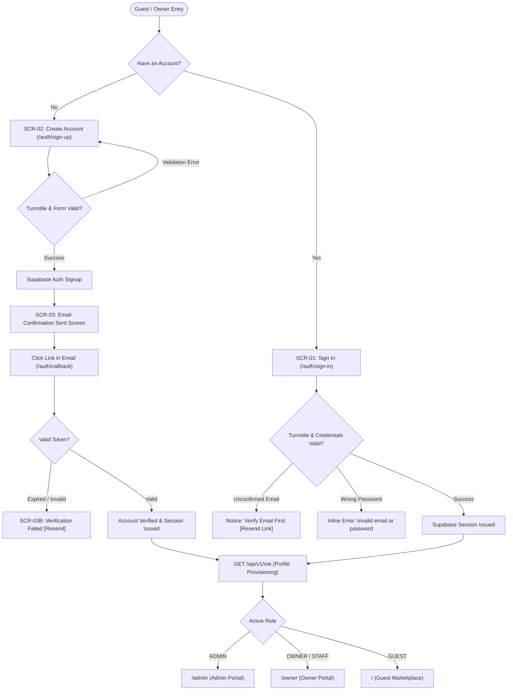

# FindStay — Authentication Flows & Screen Specifications (`S1-04-T1`)

- **Task:** [`S1-04-T1`](../scrum/sprint-01/stories/S1-04/tasks/S1-04-T1.md)
- **Story:** [`S1-04`](../scrum/sprint-01/stories/S1-04/README.md) — Sign-Up, Confirmation & Sign-In
- **Role:** UI/UX Design (`ui-ux`)
- **Visual Assets:**
  - [`docs/design/wireframes/SCR-01-Sign-In.png`](./wireframes/SCR-01-Sign-In.png)
  - [`docs/design/wireframes/SCR-02-Create-Account.png`](./wireframes/SCR-02-Create-Account.png)
  - [`docs/design/wireframes/SCR-03A-Account-Verification-OTP.png`](./wireframes/SCR-03A-Account-Verification-OTP.png)
  - [`docs/design/wireframes/SCR-03B-Email-Link-Landing.png`](./wireframes/SCR-03B-Email-Link-Landing.png)
  - [`docs/design/wireframes/SCR-06D-Session-Expired-Redirect.png`](./wireframes/SCR-06D-Session-Expired-Redirect.png)
  - [`docs/design/wireframes/SCR-17-Admin-Sign-In.png`](./wireframes/SCR-17-Admin-Sign-In.png)
- **Design Tokens:**
  - Canvas: White `#FFFFFF`
  - Supporting Surface: Ivory `#F7F3EA`
  - Primary Accent: Olive `#55624A`
  - Action / Accent: Terracotta `#BC6746`
  - Text: Ink `#18181B` / Muted `#71717A`
  - Typography: Roboto (Headings) + Work Sans (Body)

This document provides the exact screen-by-screen specification, form validation rules, responsive layouts (360px mobile & desktop), and error states for implementing **`S1-04-T6`** (React screens) and **`S1-04-T7`** (QA verification).

---

## 1. Screen Inventory & Flow Overview

---

## 2. Screen Specifications

### 2.1 `SCR-02`: Create Account (`/auth/sign-up`)
Allows new guests or property owners to register using an email address and secure password.

#### Form Fields & Controls:
1. **Full Name:**
   - Input Type: `text` (`autocomplete="name"`)
   - Validation: Required, min 2 characters, max 100 characters.
   - Error: *"Please enter your full name."*
2. **Email Address:**
   - Input Type: `email` (`autocomplete="email"`, `inputmode="email"`)
   - Validation: Required, standard email syntax, trimmed and lowercased.
   - Error: *"Please enter a valid email address."* / *"An account with this email already exists. [Sign In instead]"*
3. **Phone Number (Optional in Release R1):**
   - Input Type: `tel` (`autocomplete="tel"`, `inputmode="tel"`)
   - Placeholder: `+233 XX XXX XXXX`
   - Validation: Optional; if provided, must match Ghanaian E.164 pattern (`+233...` or `0...`).
4. **Password:**
   - Input Type: `password` (`autocomplete="new-password"`)
   - Requirements: Minimum 8 characters, at least 1 uppercase letter, 1 lowercase letter, 1 number.
   - Live Feedback: Dynamic strength checklist below field:
     - `[✓]` At least 8 characters
     - `[✓]` Uppercase & lowercase letters
     - `[✓]` At least 1 number
5. **Ghana Act 843 Privacy Notice & Terms Checkbox (`BRL-01`, `S1-11`):**
   - Mandatory Checkbox: *"I agree to the FindStay Terms of Service and consent to data processing under the Ghana Data Protection Act (Act 843) as described in the [Privacy Notice](/privacy)."*
   - Error: *"You must agree to the privacy notice and terms to create an account."*
6. **Cloudflare Turnstile Bot Protection:**
   - Embedded Turnstile widget.
   - Auto-verified before enabling submit button.
7. **Submit Button:**
   - Label: `"Create account"`
   - Loading State: Spinner with label `"Creating account..."`
   - Disabled when form has validation errors or Turnstile is pending.
8. **Footer Link:**
   - *"Already have an account? [Sign in]"* (`/auth/sign-in`)

---

### 2.2 `SCR-01`: Sign In (`/auth/sign-in`)
Authenticates existing users into their account session.

#### Form Fields & Controls:
1. **Email Address:**
   - Input Type: `email` (`autocomplete="username"`)
   - Validation: Required, standard email syntax.
2. **Password:**
   - Input Type: `password` (`autocomplete="current-password"`)
   - Validation: Required.
   - Actions: Toggle show/hide password visibility icon.
3. **Forgot Password Link:**
   - Right-aligned link: *"[Forgot password?]"* (`/auth/forgot-password`).
4. **Cloudflare Turnstile Bot Protection:**
   - Embedded Turnstile widget.
5. **Submit Button:**
   - Label: `"Sign in"`
   - Loading State: Spinner with label `"Signing in..."`
6. **Footer Link:**
   - *"Don't have an account? [Create account]"* (`/auth/sign-up`).

#### Error & Alert States:
- **Invalid Credentials:** Red banner at top of card: *"Invalid email or password. Please try again."*
- **Unverified Account:** Amber banner: *"Your email has not been verified yet. Check your inbox or [resend verification email]."*
- **Account Suspended:** Red alert: *"This account has been suspended by an administrator. Please contact support."*

---

### 2.3 `SCR-03A` & `SCR-03B`: Verification Confirmation
Handles post-registration confirmation.

#### `SCR-03A` (Check Your Inbox Message):
- Displayed immediately after successful registration.
- Visual: Envelope illustration in Olive/Ivory.
- Heading: `"Verify your email"`
- Subheading: `"We sent a confirmation link to user@example.com. Click the link in your email to activate your FindStay account."`
- Actions:
  - Button: `"Resend verification email"` (with 60-second cooldown countdown timer).
  - Link: *"[Back to sign in]"*.

#### `SCR-03B` (Verification Link Landing / Callback `/auth/callback`):
- Handles incoming link tokens from email verification.
- **Success State:** Green checkmark icon -> `"Email verified successfully! Taking you to your dashboard..."` -> Auto-redirects to `/` or `/owner` via `/api/v1/me`.
- **Already Verified State:** `"Your email is already verified. [Proceed to sign in]"`.
- **Expired / Invalid Token State:** Amber warning icon -> `"This verification link has expired or is invalid. [Request a new verification link]"`.

---

### 2.4 `SCR-06D`: Session Expired Redirect
Handles token expiration (`TA-08`: 1-hour access token lifecycle).

- Trigger: Backend returns `401 Unauthorized` and Supabase refresh token fails or is expired.
- Behavior: Clean banner overlay on top of screen preserving the user's intended target route:
  - Banner: *"Your session has expired for your security. Please sign in again to continue."*
  - Automatically redirects to `/auth/sign-in?redirect=<current_path>`.
  - Upon successful sign-in, user is returned directly to `<current_path>` without losing context.

---

### 2.5 `SCR-17`: Admin Portal Sign In (`/admin/login`)
Dedicated authentication path for platform staff and administrators.

- URL: `/admin/login`
- Visual Treatment: Elevated security badge, dark header accent.
- Flow: Standard email/password entry -> backend validates role in `identity.role` -> if role is not `ADMIN`, returns `403 Forbidden` (*"Access denied: this area is restricted to FindStay administrators."*).

---

## 3. Responsive Layout Specifications

### 3.1 Mobile Viewport (`360px – 767px`)
- **Container:** Full width (`100%`), `16px` horizontal padding.
- **Card:** Flat or subtle border on white background (`#FFFFFF`), no outer margins on small phones to maximize keyboard and touch real estate.
- **Form Controls:** Touch targets strictly minimum **`48px` height** (`py-3`).
- **Typography:**
  - Screen Title: `text-xl` (`20px`, font-bold, text-ink).
  - Body Text: `text-sm` (`14px`, text-muted).
  - Input Labels: `text-xs` (`12px`, font-medium, uppercase tracking-wide).
  - Error Copy: `text-xs` (`12px`, text-red-600 with exclamation icon).
- **Keyboard Optimization:**
  - Email field invokes `@` key keyboard (`inputmode="email"`).
  - Name field invokes capitalized keyboard (`autocapitalize="words"`).

### 3.2 Desktop Viewport (`768px+`)
- **Container:** Centered card with `max-w-md` (`448px`).
- **Surface:** White card with `rounded-xl`, subtle border (`border-stone-200`), and soft shadow (`shadow-sm`).
- **Page Canvas:** Clean light background (`#FFFFFF` with `#F7F3EA` accents).
- **Brand Identity:** Centered FindStay logo and wordmark above the form.

---

## 4. UI Component Seams (for `S1-04-T6`)

To build these screens efficiently in React without code duplication:
1. **`FormField`:** Shared label, input, help text, and inline error component ([`web/src/components/ui/FormField.tsx`](../../web/src/components/ui/FormField.tsx)).
2. **`StatusBadge`:** Standard status indicators for account states.
3. **`Toast`:** Global notifications for transient success messages (e.g. *"Verification email sent"*).
4. **`TurnstileWidget`:** React wrapper around Cloudflare Turnstile bot verification challenge.
