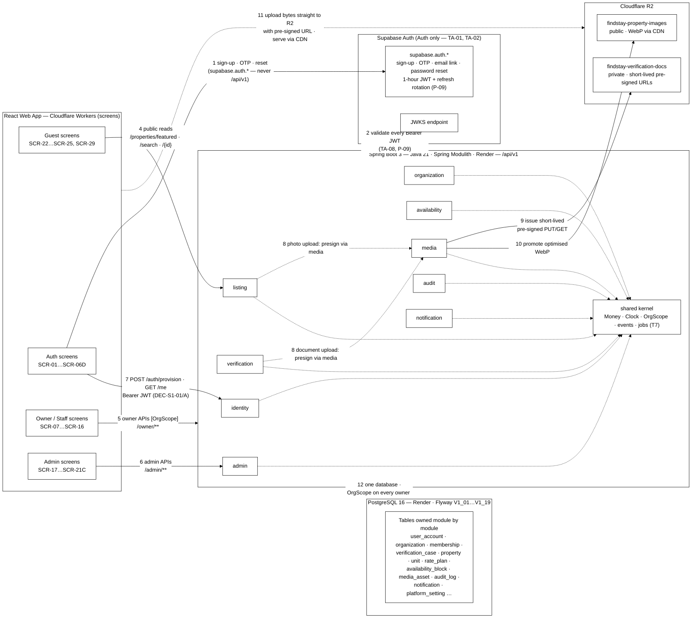
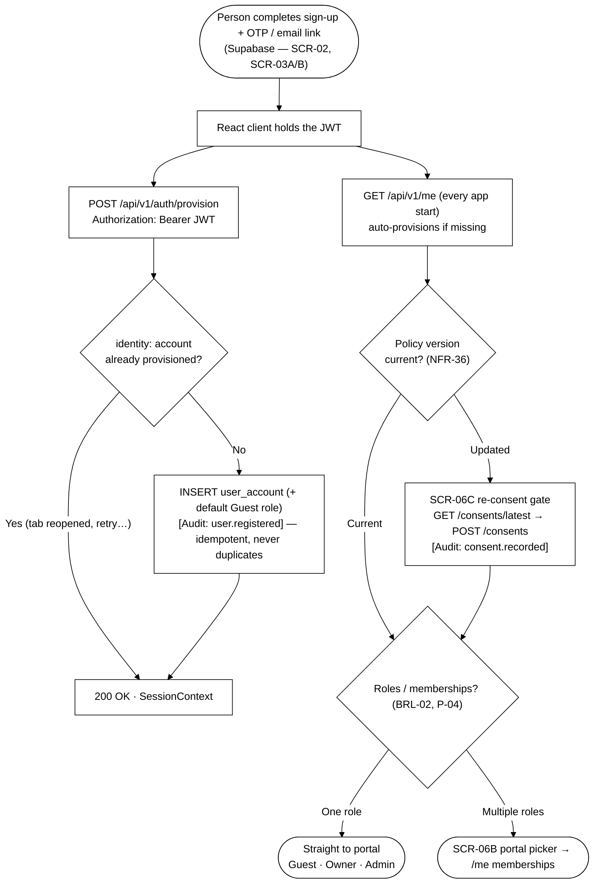
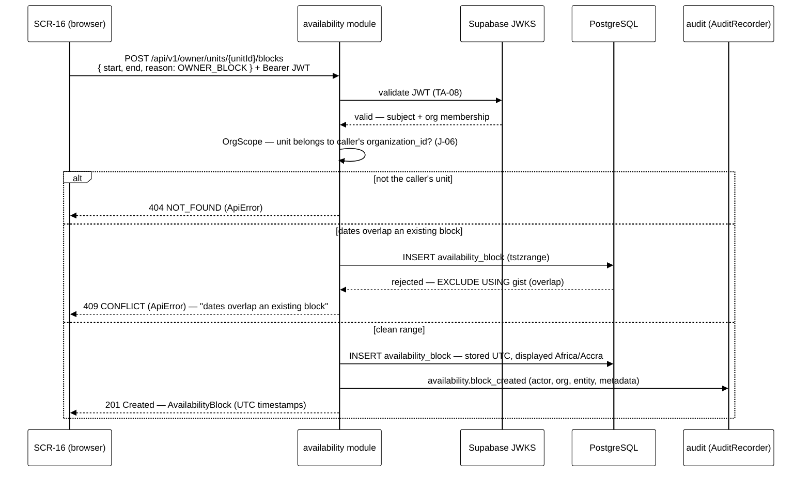

# FindStay — Backend Architecture Map & Data-Flow (`S1-01-T6`)

- **Task:** [`S1-01-T6`](../../scrum/sprint-01/stories/S1-01/tasks/S1-01-T6.md) (Issue [#30](https://github.com/ObboyeBossman/findstay/issues/30))
- **Story:** [`S1-01: Project Setup & System Design`](../../scrum/sprint-01/stories/S1-01/README.md) — Release `R1`
- **Owner:** @ObboyeBossman (Bossman Abraham N. O.) — Product Owner
- **Status:** In Review (contracts pending team sign-off — see [§8 Review agenda](#8-review-agenda-checklist-item-5))
- **Decisions recorded in:** [`docs/decisions/dec-s1-01-t6-backend-contracts.md`](../decisions/dec-s1-01-t6-backend-contracts.md) (`DEC-S1-01/A/B/C`)

This document is the backend half of the Sprint 1 system design. It names the big
parts of the back end, shows how data travels between the screens, the parts, and
the database, and defines the exact agreement (what each part accepts and returns)
that the frontend and backend build against. The machine-readable agreement is
[`api/openapi.yaml`](../../../api/openapi.yaml) (OpenAPI 3.1.0, single file).

It is the direct input to **T8 (ERD)**, the final review reference for **T7
(shared kernel, PR #37)**, and the API reference for **T5 (frontend)** and **T11
(CI OpenAPI-diff gate)**.

---

## 1. The Ten Sprint 1 Modules (Canonical)

Sprint 1 is built as a modular monolith: one deployable Spring Boot application
(`api/`), ten modules with strict boundaries. Every module exposes a public `api`
package and keeps its entities, repositories, and services inside `internal`
(`C5`, `C6`). This is the canonical list **T8 builds the ERD against**.

| # | Module (`com.findstay.*`) | Public seam | Stories | Tables owned (R1) |
| :--- | :--- | :--- | :--- | :--- |
| 1 | `shared` | `OrgScope`, `Money`, `Clock`, event bus | `S1-01` | *(kernel only — no tables)* |
| 2 | `identity` | — | `S1-04`, `S1-05`, `S1-06` | `user_account`, `role` |
| 3 | `organization` | `OrgScope` filter implementation | `S1-07` | `organization`, `membership`, `membership_permission` |
| 4 | `verification` | — | `S1-11`, `S1-12` | `verification_case`, `verification_document`, `review_decision`, `consent_record` |
| 5 | `listing` | `CatalogQuery` (published listing/unit projections) | `S1-13`, `S1-15` | `property`, `unit`, `amenity`, `rate_plan`, `listing`, `listing_status_history` |
| 6 | `availability` | `AvailabilityGate` | `S1-14` | `availability_block` |
| 7 | `media` | — | `S1-09` | `media_asset`, `document` |
| 8 | `audit` | `AuditRecorder` | `S1-08` | `audit_log` |
| 9 | `notification` | `NotificationSender` | `S1-10` | `notification`, `notification_template`, `notification_preference` |
| 10 | `admin` | — | `S1-15`, `S1-16` | `platform_setting` |

Notes:

- The module formerly drafted as `catalog` is **`listing`** — `CatalogQuery` is the
  seam interface *inside* `listing.api`, not the module name
  ([`DEC-S1-01/B`](../decisions/dec-s1-01-t6-backend-contracts.md)). Package and
  web feature folder were renamed before any code landed.
- `organization`, `audit`, and `media` are legitimate Sprint 1 modules that the
  original rules row missed; the rules file has been patched to list all ten
  ([`DEC-S1-01/B`](../decisions/dec-s1-01-t6-backend-contracts.md)).
- A dash ("—") in the seam column means "no rule-02-named seam interface"; every
  module still has a public `api` package, and any cross-module call must go
  through the callee's public `api` package, a published domain event, or one of
  the eight extension seams (`C6`) — for example, `verification` and `listing`
  both ask `media` for pre-signed upload URLs through `media`'s public `api`
  package.

### Module dependency & ERD order (for T8)

Cross-module references are **UUID columns carrying a logical reference — never
enforced foreign keys** (Modulith boundary rule, `C5`/`C6`). Real FK constraints
only exist between tables inside the same module. T8 draws cross-module edges as
logical arrows.

```text
shared          ← no dependencies (kernel)
identity        ← shared
organization    ← shared, identity
verification    ← shared, identity, organization, media
listing         ← shared, organization
availability    ← shared, listing        (unit_id UUID ref)
media           ← shared, organization
audit           ← shared                 (entity_type/entity_id — generic, no cross-module FKs)
notification    ← shared, identity
admin           ← shared, identity, organization, verification, listing, audit
```

> **Open point for T8 (DEC-S1-01/B):** the S1-13/S1-15 acceptance criteria mention
> database schemas as `catalog.property`, `catalog.listing_status_history`. T8
> decides whether the PostgreSQL schema keeps the name `catalog` or follows the
> module name `listing`. Nothing in the code depends on this yet.

---

## 2. The Backend Map — One Picture

The system in one picture: the React web app (screens for guests, owners/staff,
admins), Supabase Auth (the only sign-up/sign-in/reset system the browser talks
to), the Spring Boot API on Render (the ten modules behind `/api/v1`), Cloudflare
R2 (photos public, verification documents private), and PostgreSQL on Render
(one database, tables owned module by module, isolated by `organization_id`).



Reading the numbered flows: (1) the browser only ever authenticates against
Supabase Auth; (2) every `/api/v1` request carries the Supabase-issued JWT, which
the API verifies against Supabase's JWKS endpoint; (3) all business data flows
through `/api/v1` — the browser never touches the database or R2 directly;
(4)–(7) screen groups map to module-owned endpoint groups; (8)–(11) uploads are
two-step — the API authorises and issues a short-lived pre-signed URL, then the
browser uploads the bytes straight to R2; (12) every owner-scoped read/write is
filtered by `organization_id` (`OrgScope`, `J-06`).

---

## 3. How Data Flows — Screen In, Module Processing, Database, Back Out

### 3.1 Account creation & session bootstrap (DEC-S1-01/A)

The React app owns the whole Supabase-side journey; the API is first touched at
two points: **provision** (create the local account record after confirmation)
and **`GET /me`** (load roles, memberships, and portal routing on every app
start).



What the API does **not** do in Release R1: it never handles registration forms,
OTP codes, or password resets — those live entirely in Supabase
(`supabase.auth.*`). Consequently the Supabase-side events (failed logins, OTP
attempts, reset requests) are not written to `audit.audit_log` by our API in R1;
the API records `user.registered` (at provision), `auth.login_success` (first
`/me` of a session), `consent.recorded`, and the profile/consent updates listed
in §4.5. Capturing Supabase-side auth events is deferred improvement
`DEC-S1-01/A-F1`.

### 3.2 Owner blocks dates on a unit (worked example — full request lifecycle)

This one flow exercises every rule: JWT validation, tenant isolation, the
`btree_gist` overlap lock, the audit seam, and the shared error contract.



### 3.3 Screen groups → module-owned endpoints (the full map)

| Screen group (T3) | Calls | Module owning the endpoints |
| :--- | :--- | :--- |
| Auth & profile (`SCR-01`–`SCR-06D`) | `supabase.auth.*`, then `POST /auth/provision`, `GET/PATCH /me` | `identity` (Supabase for auth itself) |
| Notification preferences (`SCR-06`) | `GET/PUT /me/notifications/preferences` | `notification` |
| Consent gate (`SCR-06C`) | `GET /consents/latest`, `POST /consents` | `verification` |
| Owner dashboard & org (`SCR-07`, `SCR-08`, `SCR-08B`) | `/owner/dashboard`, `/owner/org`, `/owner/invitations`, `/invitations/{token}` | `organization` |
| Owner verification (`SCR-09`, `SCR-10`) | `/owner/verification*` (presign, submit, status) | `verification` (presign via `media`) |
| Properties, units, photos (`SCR-07B`, `SCR-11`–`SCR-14`) | `/owner/properties*` (+ units, photos/presign, preview, submit) | `listing` (photos via `media`) |
| Availability calendar (`SCR-15`, `SCR-16`) | `/owner/units/{unitId}/availability`, `/owner/units/{unitId}/blocks` | `availability` |
| Admin review & platform (`SCR-17`–`SCR-21C`) | `/admin/*` (dashboard, reviews, users, settings, audit-logs) | `admin` |
| Public guest (`SCR-22`–`SCR-25`, `SCR-29`) | `/properties/featured`, `/properties/search`, `/properties/{id}` | `listing` (public `CatalogQuery` reads) |
| Guest session & history (`SCR-25A`) | `/visitor-sessions*`, `/me/recently-viewed*` | **Sprint 2+ — excluded from R1** |

---

## 4. Cross-Cutting Conventions (Every Contract Uses These)

These are the shared agreements every module's contract builds on. Items marked
**(T7)** are already delivered and tested in the merged shared kernel
([PR #37](https://github.com/ObboyeBossman/findstay/pull/37)) — this section is
the final review reference for T7.

### 4.1 Money — integer pesewas (T7 `Money`)

All amounts are `integer` pesewas (`1 GHS = 100 pesewas`), always paired with
`"currency": "GHS"`. `250000` means GH₵2,500.00. Floating-point money is
forbidden (`NFR-08`, rule 03). The browser formats for display only; the API
never sends decimal GHS.

### 4.2 Time — UTC in, Ghana time out (T7 `Clock` / `GhanaTime`)

All timestamps in requests and responses are ISO-8601 UTC (`2026-11-17T09:30:00Z`,
stored `TIMESTAMPTZ`). Screens display `Africa/Accra` (`NFR-52`). A date the
owner picks as "24 November" on the calendar means the UTC range of the
`Africa/Accra` day.

### 4.3 Errors — one shape, stable codes (T7 `ApiError` / `ErrorCode`)

Every error response has exactly this shape:

```json
{
  "code": "VALIDATION_FAILED",
  "message": "Validation failed",
  "status": 400,
  "timestamp": "2026-11-17T09:30:00Z",
  "path": "/api/v1/owner/units/8f…/blocks",
  "details": [ { "field": "end", "message": "must follow start" } ]
}
```

Stable codes (clients switch on `code`, never on `message`): `BAD_REQUEST`,
`VALIDATION_FAILED` (400) · `UNAUTHENTICATED` (401) · `FORBIDDEN` (403) ·
`NOT_FOUND` (404) · `METHOD_NOT_ALLOWED` (405) · `CONFLICT` (409) ·
`UNSUPPORTED_MEDIA_TYPE` (415) · `BUSINESS_RULE_VIOLATION` (422) ·
`RATE_LIMITED` (429) · `INTERNAL_ERROR` (500). Codes are additive; they are never
renamed (`C3`).

### 4.4 Identity & tenant isolation (T7 `OrgScope`)

Every request carries `Authorization: Bearer <Supabase JWT>`; the API validates
it via JWKS and resolves the caller's active memberships (`P-09`, `TA-08`).
Every owner-scoped endpoint is `[OrgScope]`: it filters by `organization_id`
derived from the caller's membership — a client-supplied organisation id is
never trusted as authority (`J-06`, `BRL-04`). Owner A can never read or mutate
Owner B's records. Owner-scoped reads of another organisation's data return
`404`, not `403` (no existence leak).

### 4.5 Audit — append-only trail (T7 `AuditRecorder` seam)

Sensitive actions write an immutable record via `audit.audit_log`:
`user.registered` (provision) · `auth.login_success` (first `/me` of a session)
· `consent.recorded` · `user.profile_updated` · `org.staff_invited` /
`org.staff_role_updated` / `org.staff_invite_accepted` · `verification.submitted`
/ `verification.approved` / `verification.rejected` · `listing.draft_saved` /
`listing.paused` / `listing.reactivated` / `listing.submitted` /
`listing.photos_updated` / `listing.approved` / `listing.corrections_requested` /
`listing.rejected` · `unit.created` / `unit.updated` ·
`availability.block_created` / `availability.block_removed` · `user.suspended` /
`user.restored` · `platform.setting_updated` (`BRL-13`, `BRL-16`, `NFR-66`).
Rows are never updated or deleted.

### 4.6 Media — two-step uploads (T7 kernel, `media` module)

Uploads never stream through the API. Step 1: the owning module (verification
for documents, listing for photos) asks `media` to authorise and issue a
short-lived pre-signed R2 URL after OrgScope + MIME/size validation
(≤ 5 MB, `NFR-17`, `TA-13`). Step 2: the browser PUTs the bytes straight to R2.
Listing photos land in the public WebP bucket behind the CDN; Ghana Cards,
ownership proof and GTA licences land in the private bucket and are only ever
read back through authorised short-lived pre-signed GETs (`NFR-24`). Ghana Card
numbers are encrypted at rest (AES-256, `NFR-28`, `TA-09`) — the number never
appears in API responses.

### 4.7 Notifications — template-seam driven (T7, `notification` module)

`NotificationSender` is the single seam (`P-08`): In-App + Email in R1, SMS
adapter plugged in behind the same interface when the Ghana sender-ID keys land.
Templates are keyed by event type (`LISTING_APPROVED`, `BOOKING_CONFIRMED`, …)
in `notification_template` and added by seed data, not code changes. Triggers
follow the T3 notification matrix (sign-up verification, resets, staff invites,
verification/listing decisions, suspension/restore).

### 4.8 Pagination

List endpoints use `limit` (default 20, max 100) + `offset`, and return
`{ items: [...], total: n }`. Flagged for confirmation in the review agenda (§8)
— if the team prefers cursor pagination for the admin queues, that is a
contract-level change to agree now, not later.

---

## 5. API Agreement Summary

The machine-readable contract is **`api/openapi.yaml`** (OpenAPI 3.1.0, single
file, all `/api/v1/*` operations, generated-by-springdoc once controllers exist —
[`DEC-S1-01/C`](../decisions/dec-s1-01-t6-backend-contracts.md)). Every operation
carries extensions for traceability:

- `x-module` — the owning module from §1;
- `x-org-scope: true` — the endpoint enforces `organization_id` isolation;
- `x-audit-event` — the `audit.audit_log` action(s) the operation records.

| Module | Endpoints (path prefix) | Security |
| :--- | :--- | :--- |
| `identity` | `POST /auth/provision`, `GET /me`, `PATCH /me` | Bearer JWT |
| `notification` | `GET/PUT /me/notifications/preferences` | Bearer JWT |
| `verification` | `GET /consents/latest`, `POST /consents`, `GET /owner/verification`, `POST /owner/verification/presign`, `POST /owner/verification/submit` | Bearer JWT · OrgScope on `/owner/*` |
| `organization` | `GET /owner/dashboard`, `GET/PATCH /owner/org`, `POST /owner/invitations`, `GET /invitations/{token}`, `POST /invitations/{token}/accept` | Bearer JWT · OrgScope on `/owner/*`; invitation endpoints are token-authorised |
| `listing` | `GET/POST /owner/properties`, `GET/PATCH/… /owner/properties/{id}` (+ `/units`, `/photos/presign`, `/photos`, `/preview`, `/submit`), `GET /properties/featured`, `GET /properties/search`, `GET /properties/{id}` | Bearer JWT · OrgScope on `/owner/*`; the three public reads are anonymous |
| `availability` | `GET /owner/units/{unitId}/availability`, `POST /owner/units/{unitId}/blocks`, `DELETE /owner/units/{unitId}/blocks/{blockId}` | Bearer JWT · OrgScope |
| `media` | *(no direct REST — serves verification & listing through its public `api` package)* | — |
| `audit` | *(no direct REST — `AuditRecorder` seam; viewed through `admin`)* | — |
| `admin` | `GET /admin/dashboard`, `GET /admin/reviews`, `GET /admin/reviews/{id}`, `POST /admin/reviews/{id}/decision`, `GET /admin/users`, `POST /admin/users/{id}/suspend`, `POST /admin/users/{id}/restore`, `GET/PATCH /admin/settings`, `GET /admin/audit-logs` | Bearer JWT · Admin role |
| `shared` | *(no endpoints)* | — |

---

## 6. Cross-Check Against the T3 User Flows (Checklist Item 4)

T3's API-contract appendix (`docs/design/user-flows.md` §9) listed every endpoint
the flows need. Each one is accounted for below — **nothing a Sprint 1 flow needs
is missing from the contract**. Dispositions: **Defined** (in `api/openapi.yaml`),
**Supabase-side** (handled by `supabase.auth.*` in the browser — `DEC-S1-01/A`),
**Added** (new endpoint this decision introduces), **Refined** (T3 shorthand
given a precise path), **Sprint 2+** (explicitly excluded from R1).

| T3 endpoint | Disposition | In the contract as |
| :--- | :--- | :--- |
| `POST /api/v1/auth/session` | Refined | `GET /api/v1/me` (session bootstrap after Supabase sign-in) |
| `POST /api/v1/auth/register` | Supabase-side | `supabase.auth.signUp` — no API endpoint in R1 |
| `POST /api/v1/auth/verify-otp` | Supabase-side | `supabase.auth.verifyOtp` |
| `GET /api/v1/auth/verify-email` | Supabase-side | Supabase email link → client landing screen |
| `POST /api/v1/auth/password-reset/request` | Supabase-side | `supabase.auth.resetPasswordForEmail` |
| `POST /api/v1/auth/password-reset/confirm` | Supabase-side | `supabase.auth.updateUser` with the recovery session |
| *(new — `DEC-S1-01/A`)* | **Added** | `POST /api/v1/auth/provision` (idempotent account provisioning) |
| `GET/PATCH /api/v1/me` | Defined | `identity` — session context, profile update |
| `GET/PUT /api/v1/me/notifications/preferences` | Defined | `notification` |
| `GET /api/v1/consents/latest` · `POST /api/v1/consents` | Defined | `verification` |
| `GET /api/v1/owner/dashboard` | Defined | `organization` |
| `GET/PATCH /api/v1/owner/org` | Defined | `organization` |
| `POST /api/v1/owner/invitations` | Defined | `organization` |
| `GET /api/v1/invitations/{token}` | Defined | `organization` (token-authorised) |
| `POST /api/v1/invitations/{token}/accept` | Defined | `organization` (token-authorised) |
| `POST /api/v1/owner/verification/presign` | Defined | `verification` (issues URL via `media`) |
| `POST /api/v1/owner/verification/submit` | Defined | `verification` |
| `GET /api/v1/owner/verification` | Defined | `verification` |
| `GET/POST /api/v1/owner/properties` | Defined | `listing` |
| `GET/PATCH /api/v1/owner/properties/{id}` | Defined | `listing` |
| `GET /api/v1/owner/properties/{id}/preview` | Defined | `listing` |
| `POST /api/v1/owner/properties/{id}/submit` | Defined | `listing` (409 if locked under review) |
| `POST/PATCH/DELETE /api/v1/owner/properties/{id}/units` | Defined | `listing` |
| `POST /api/v1/owner/properties/{id}/photos/presign` | Defined | `listing` (issues URL via `media`) |
| `PUT/DELETE /api/v1/owner/properties/{id}/photos` | Refined | `PUT …/photos` (reorder + cover), `DELETE …/photos/{photoId}` |
| `GET /api/v1/owner/units/{unitId}/availability` | Defined | `availability` |
| `POST/DELETE /api/v1/owner/units/{unitId}/blocks` | Refined | `POST …/blocks`, `DELETE …/blocks/{blockId}` |
| `GET /api/v1/admin/dashboard` | Defined | `admin` |
| `GET /api/v1/admin/reviews` | Defined | `admin` (queue: pending reviews) |
| `GET /api/v1/admin/reviews/{id}` | Defined | `admin` |
| `POST /api/v1/admin/reviews/{id}/decision` | Defined | `admin` (approve / corrections / reject; 409 if already decided) |
| `GET /api/v1/admin/users` | Defined | `admin` |
| `POST /api/v1/admin/users/{id}/suspend` · `…/restore` | Defined | `admin` |
| `GET/PATCH /api/v1/admin/settings` | Defined | `admin` |
| `GET /api/v1/admin/audit-logs` | Defined | `admin` (reads `audit` via its public `api` package) |
| `GET /api/v1/properties/featured` | Defined | `listing` (anonymous) |
| `GET /api/v1/properties/search` | Defined | `listing` (anonymous) |
| `GET /api/v1/properties/{id}` | Defined | `listing` (anonymous) |
| `POST /api/v1/visitor-sessions` · `…/recently-viewed` | Sprint 2+ | Excluded from R1 (visitor session/history) |
| `POST/GET/DELETE /api/v1/me/recently-viewed*` | Sprint 2+ | Excluded from R1 |
| `POST /api/v1/bookings*` | Sprint 2+ | Excluded from R1 (booking & checkout) |

Error paths the flows demand, present in the contract: `409 CONFLICT` (submit
under active review, availability overlap, review already decided), `404
NOT_FOUND` (cross-org access, unknown property), `403 FORBIDDEN` (non-admin on
`/admin`), `422 BUSINESS_RULE_VIOLATION` (missing fix notes / rejection reason),
`429 RATE_LIMITED` (provision and sensitive operations, `NFR-23`).

---

## 7. What T8 Receives From This Document

1. The **ten-module table** (§1) with every table each module owns — the ERD's
   module-by-module checklist.
2. The **dependency order and the UUID-not-FK rule** (§1) — cross-module
   references are logical arrows; enforced FKs stay inside a module.
3. **Column conventions** from §4: money as `BIGINT` integer pesewas +
   `currency = 'GHS'`; timestamps `TIMESTAMPTZ` UTC; `audit_log` append-only as
   `(actor_id, org_id, action, entity_type, entity_id, metadata_json,
   created_at)`; Ghana Card numbers encrypted at rest (AES-256).
4. **Two tables T3's sign-off checklist names explicitly** —
   `notification_preference` and `consent_record` — both present in §1
   (`notification` and `verification` respectively).
5. The **open point**: PostgreSQL schema naming (`catalog` vs `listing`) —
   DEC-S1-01/B leaves this to T8.

---

## 8. Review Agenda (Checklist Item 5)

The contract is written and self-consistent; these are the specific points to
agree with the frontend and backend before sign-off. None is large — each is a
confirm-or-adjust:

1. **Pagination style** — `limit`/`offset` as drafted (§4.8), or cursor-based for
   the admin queues?
2. **Auth audit events under DEC-S1-01/A** — API records `user.registered`
   (provision), `auth.login_success` (first `/me` of a session), and consent
   events; Supabase-side events (failed logins, OTP attempts, reset requests)
   are not in our audit trail in R1. Acceptable for R1, with `DEC-S1-01/A-F1` as
   the improvement path?
3. **Property/Unit field sets** — the drafted schema fields in `api/openapi.yaml`
   cover the S1-13 flows (details, location, amenities, rules, units with pesewa
   rate + billing period, photos ≤ 10). Confirm or extend.
4. **Photo management paths** — bulk `PUT` for reorder/cover + per-photo `DELETE`
   as drafted?
5. **Search filter parameters (R1)** — destination, dates, guests, accommodation
   type, price range as drafted?
6. **Owner/Admin dashboard payloads** — the KPI sets in the contract are
   proposals; confirm the KPI list per screen.
7. **Invitation acceptance for existing accounts** — sign in then accept, as
   drafted?
8. **DB schema naming** — `catalog` or `listing` (T8 decides, DEC-S1-01/B).

**Reviewers:** @maskkuratahiru-wq (frontend, T5) · @joseibonsu206-gif (backend,
T7) · @fummey (database, T8) · Product Owner sign-off (@ObboyeBossman).

---

## 9. Traceability

| Module | Stories (R1) | Requirement / decision IDs honoured |
| :--- | :--- | :--- |
| `shared` | `S1-01` | Kernel primitives (T7, PR #37) |
| `identity` | `S1-04`, `S1-05`, `S1-06` | `FR-01`, `FR-03`, `FR-05`, `FR-07`, `BRL-02`, `P-04`, `P-09`, `NFR-19`, `NFR-22`, `NFR-23`, `TA-07`, `TA-08` |
| `organization` | `S1-07` | `FR-09`, `BRL-04`, `BRL-05`, `J-06`, `UR-O15`, `UR-PM03`, `UR-PS01`, `UR-PSN01` |
| `verification` | `S1-11`, `S1-12` | `FR-08`, `P-12`, `NFR-28`, `NFR-31`, `NFR-32`, `NFR-34`–`NFR-36`, `TA-09`, `UR-O01` |
| `listing` | `S1-13`, `S1-15`, `S1-03` (public reads) | `FR-11`–`FR-18`, `FR-22`, `FR-39`, `FR-40`, `UR-O02`, `BRL-06`, `P-02` |
| `availability` | `S1-14` | `P-02` (unit model, `btree_gist` overlap lock), `FR-11`–`FR-18` (calendar behaviour) |
| `media` | `S1-09` | `FR-14`, `TA-13`, `NFR-17`, `NFR-24` |
| `audit` | `S1-08` | `BRL-13`, `BRL-16`, `NFR-66` |
| `notification` | `S1-10` | `FR-66`–`FR-71`, `BRL-17`, `P-08` |
| `admin` | `S1-15`, `S1-16` | `FR-87`, `FR-88`, `BRL-16`, `NFR-28` |

Platform-wide rules honoured throughout: `TA-01`, `TA-02` (no browser business-data
access — `/api/v1` only), `TA-08` (JWKS), `NFR-08` (pesewas display/store),
`NFR-52` (UTC store / `Africa/Accra` display), `NFR-21` (TLS 1.2+), `C1`–`C8`
(additive-only evolution). Decisions: `DEC-S1-01/A/B/C` recorded in
[`docs/decisions/dec-s1-01-t6-backend-contracts.md`](../decisions/dec-s1-01-t6-backend-contracts.md).

---

*This document changes additively. Behaviour or contract changes get a new
decision entry in `docs/decisions/` and an updated `api/openapi.yaml`; nothing
here is rewritten silently.*
