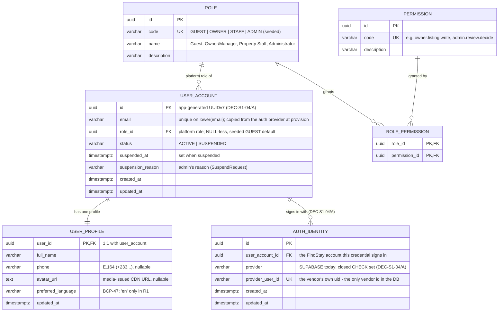
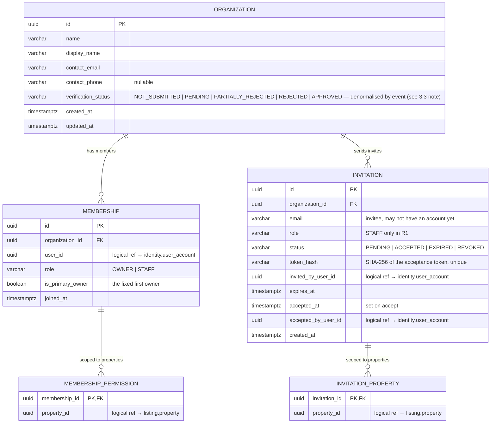
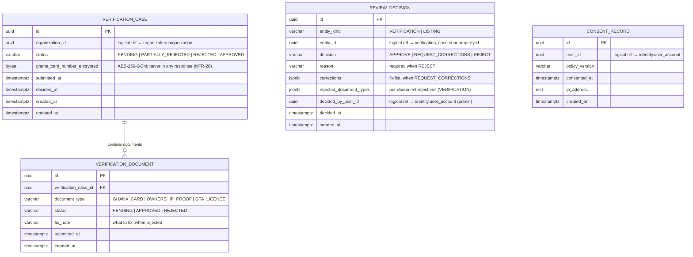
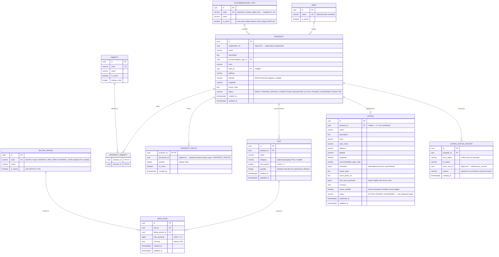
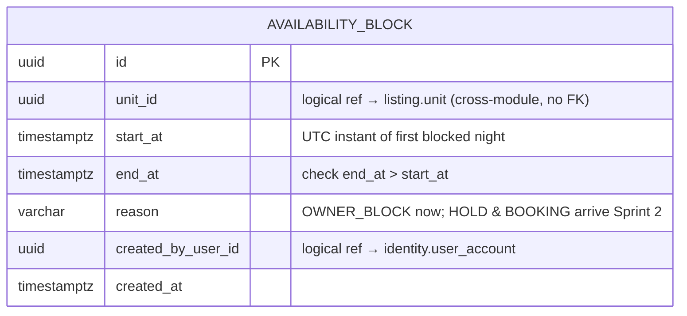
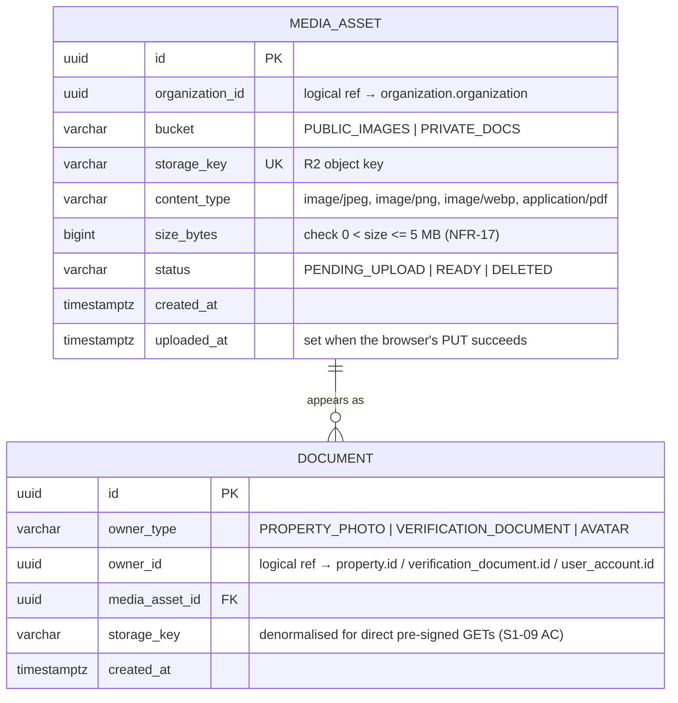
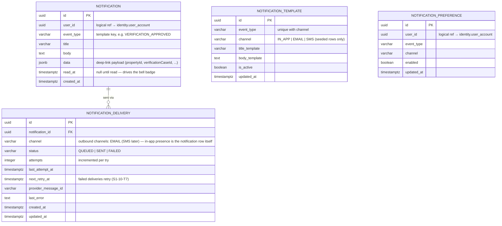
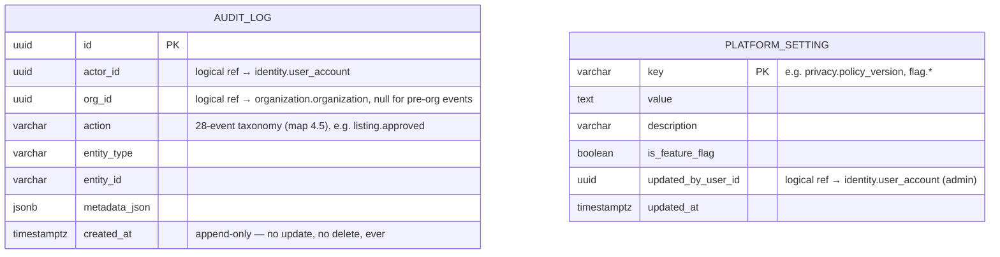

# FindStay — Entity-Relationship Diagram (`S1-01-T8`)

- **Task:** [`S1-01-T8`](../../scrum/sprint-01/stories/S1-01/tasks/S1-01-T8.md) (Issue [#32](https://github.com/ObboyeBossman/findstay/issues/32))
- **Story:** [`S1-01: Project Setup & System Design`](../../scrum/sprint-01/stories/S1-01/README.md) — Release `R1`
- **Owner:** @fummey (Solomon Fummey) — analysis & draft by @ObboyeBossman (Product Owner) from the T6 data flow
- **Status:** In Review — PR open; built from the closed T6 backend map ([`backend-architecture.md`](./backend-architecture.md), issue [#30](https://github.com/ObboyeBossman/findstay/issues/30))
- **Decisions recorded in:** [`docs/decisions/dec-s1-01-t8-erd.md`](../decisions/dec-s1-01-t8-erd.md) (`DEC-S1-01/F`–`/I`)

This is the picture of the FindStay database: **35 tables** — every table Sprint 1
must remember, its columns, and how tables connect. It was produced by analysing
and re-analysing the T6 data flow (§7 records what the analysis found), and it is
the agreed design the real database (**T9**) is built from, migration by migration
(§6 gives T9 the exact script order).

---

## 1. How to Read This Diagram (Conventions First)

Every table in this document follows the cross-cutting conventions the team
already agreed in the backend map §4:

| Rule | What it means here |
| :--- | :--- |
| **Primary keys** | `uuid` — generated by the application (`IdGenerator`, RFC 9562 **UUIDv7** — time-ordered, index-friendly), never a database default and never a serial integer. Every table, no exceptions: `user_account.id` is FindStay's own id too (DEC-S1-04/A supersedes DEC-S1-01/A's original Supabase-uid exception; the provider's uid lives only in `identity.auth_identity`). |
| **Money** | `bigint` integer **pesewas** (`250000` = GH₵2,500.00), always with `currency char(3)` = `'GHS'`. No decimal money columns anywhere (NFR-08, rule 03). |
| **Time** | every timestamp is `timestamptz`, stored UTC, displayed `Africa/Accra` (NFR-52). Columns end in `_at`. |
| **In-module foreign keys** | real `REFERENCES` constraints exist **only between tables of the same module** (Spring Modulith boundary rule, `C5`/`C6`). Drawn as solid lines in §3. |
| **Cross-module references** | a plain `uuid` column carrying a **logical reference — never an enforced FK**. Drawn as the dashed arrows in §3.0 and registered one by one in §5. Integrity is kept in code: the writing module asks the owning module's public `api` package to validate the id before it stores it. |
| **Schema naming** | one PostgreSQL schema per module, named exactly like the module — `identity`, `organization`, `verification`, `listing`, `availability`, `media`, `audit`, `notification`, `admin` (DEC-S1-01/G; supersedes the `catalog.` prefix that S1-13/S1-15 acceptance criteria mention). |
| **Enums** | small closed value sets are `varchar` + `CHECK` constraints (values listed in §4). Open, extensible value sets that owners can grow without code changes are **lookup tables** (`accommodation_type`, `billing_period`, `amenity`, `area` — NFR-46). |
| **Soft vs hard delete** | hard delete in R1 (photos, blocks). Two exceptions by design: `audit_log` rows are never deleted or updated at all (append-only), and `media_asset.status` marks DELETED so the audit trail keeps pointing at something. |
| **Updated rows** | `updated_at` is maintained by the application, not by database triggers (the T9 scripts create no triggers in R1). |

---

## 2. The Table Inventory at a Glance (Checklist Items 1 & 2)

35 tables across 9 owning modules (`shared` owns none — it is the kernel).
"**+**" marks the tables **added** after T6's canonical list — six by the analysis
(§7, `DEC-S1-01/H`) and `auth_identity` by decision (`DEC-S1-04/A`, `V1_14`).

| Module | Tables | Remembers | Stories |
| :--- | :--- | :--- | :--- |
| `identity` | `user_account`, `user_profile`, `role`, `permission`, `role_permission`, **+ `auth_identity`** | who people are, their platform role, the RBAC catalogue, and the vendor-id boundary | S1-04, S1-05, S1-06 |
| `organization` | `organization`, `membership`, `membership_permission`, **+ `invitation`**, **+ `invitation_property`** | owner companies, who belongs at which level, pending staff invites | S1-07 |
| `verification` | `verification_case`, `verification_document`, `review_decision`, `consent_record` | owner ID/property verification + privacy consents (DEC-S1-01/F) | S1-11, S1-12 |
| `listing` | `property`, `unit`, `rate_plan`, `amenity`, `area`, `listing`, `listing_status_history`, **+ `accommodation_type`**, **+ `billing_period`**, **+ `property_amenity`**, **+ `property_photo`** | properties, rooms, prices, lookups, the published search projection | S1-13, S1-15 |
| `availability` | `availability_block` | blocked calendar ranges per unit | S1-14 |
| `media` | `media_asset`, `document` | every R2 object + who owns it | S1-09 |
| `audit` | `audit_log` | the append-only action trail | S1-08 |
| `notification` | `notification`, `notification_template`, `notification_preference`, `notification_delivery` | in-app inbox, templates, preferences, delivery retries | S1-10 |
| `admin` | `platform_setting` | key-value settings & feature flags | S1-16 |

---

## 3. The Diagrams (Checklist Item 3)

### 3.0 One picture — how the modules connect through their tables

Solid arrows are in-module foreign keys; dashed arrows are the cross-module
logical UUID references (§5) and the two event edges. This is the whole Sprint 1
data flow in one view.

```mermaid
flowchart LR
    ID["identity<br/>user_account · user_profile<br/>role · permission · role_permission<br/>auth_identity"]
    ORG["organization<br/>organization · membership ·<br/>membership_permission ·<br/>invitation · invitation_property"]
    VER["verification<br/>verification_case ·<br/>verification_document ·<br/>review_decision · consent_record"]
    LST["listing<br/>property · unit · rate_plan ·<br/>amenity · area · listing ·<br/>listing_status_history ·<br/>accommodation_type · billing_period ·<br/>property_amenity · property_photo"]
    AVL["availability<br/>availability_block"]
    MED["media<br/>media_asset · document"]
    AUD["audit<br/>audit_log"]
    NOT["notification<br/>notification · notification_template ·<br/>notification_preference · notification_delivery"]
    ADM["admin<br/>platform_setting"]

    ID -. "membership.user_id ·<br/>consent_record.user_id ·<br/>audit_log.actor_id · notification.user_id" .-> ORG
    ORG -. "verification_case.organization_id ·<br/>property.organization_id" .-> VER
    ORG -. "property.organization_id" .-> LST
    VER -. "VerificationApproved(orgId) event →<br/>listing.owner_verified (badge)" .-> LST
    VER -. "case status event →<br/>organization.verification_status" .-> ORG
    LST -. "availability_block.unit_id" .-> AVL
    LST -. "membership_permission.property_id ·<br/>invitation_property.property_id" .-> ORG
    MED -. "document.owner_id → property /<br/>verification_document / avatar" .-> LST
    VER -. "verification documents via media presign" .-> MED
    LST -. "property photos via media presign" .-> MED
    AUD -. "reads through admin (admin/audit-logs)" .-> ADM
    NOT -. "user_id → user_account" .-> ID
```

### 3.1 `identity` — accounts, profiles, the RBAC catalogue

> Org-level roles (OWNER / STAFF) are **not** here — they live on
> `organization.membership.role`, because one person can be OWNER in one company
> and STAFF in another (the T3 multi-role portal picker). `identity.role` is the
> platform RBAC catalogue: `user_account.role_id` picks the platform role
> (GUEST default, ADMIN for administrators), and S1-06's table-driven permission
> checks read `role_permission` through `identity`'s public api package.
>
> `auth_identity` (DEC-S1-04/A, `V1_14`) is the vendor boundary: every external
> credential — Supabase Auth today — is one row pointing at the FindStay account.
> All business data references `user_account.id`, FindStay's permanent id, so a
> provider change never touches roles, memberships, consents or audit history.

### 3.2 `organization` — companies, memberships, staff invitations

> `invitation` is one of the tables the analysis added (DEC-S1-01/H): the API
> contract has four invitation endpoints (`GET/POST /owner/invitations`,
> `GET /invitations/{token}`, `POST /invitations/{token}/accept`) and the
> `Invitation` schema (status, expiresAt, propertyIds) — but no story names a
> table for them, and `membership` cannot hold them (an invitee has no
> `user_id` until they accept). The acceptance **token is stored hashed**; the
> raw token only ever lives in the email link.

### 3.3 `verification` — owner verification & privacy consents

> **`consent_record` lives in `verification`** (DEC-S1-01/F), even though
> S1-11's acceptance criteria wrote `identity.consent_record`: the consent
> endpoints (`GET /consents/latest`, `POST /consents`) and the Act 843 / P-12
> handling live in `verification`, and a table stays with the module that serves
> it. The column shape is exactly S1-11's: `user_id, policy_version,
> consented_at, ip_address`. S1-11's wording should be updated when that story
> starts.
>
> **`review_decision` is shared by both review queues** (S1-15's acceptance
> criteria name it for listing reviews too): `entity_kind` tells VERIFICATION
> from LISTING, `entity_id` is the logical ref. One decision table, one audit
> shape — the admin review screen (SCR-18) reads both kinds through it.
>
> `organization.verification_status` is **denormalised**: when a case is
> decided, `verification` publishes the event and `organization` updates its
> column — so the owner dashboard and org screens never query across modules.

### 3.4 `listing` — properties, rooms, prices, lookups, the public projection

> Three things to know about this module:
>
> 1. **`property` is the owner's working copy; `listing` is the public
>    projection.** Anonymous reads (`/properties/featured`, `/search`, `/{id}`)
>    go through `listing` — denormalised, search-indexed, no joins across
>    modules (`CatalogQuery` seam). Publish/refresh copies from `property` +
>    `unit`/`rate_plan` + `property_photo`; `owner_verified` arrives by event
>    from `verification` (the dashed edge in 3.0).
> 2. **`rate_plan`, not `unit`, holds the price** — one row per unit per
>    billing period (`unique(unit_id, billing_period_id)`), so the
>    monthly/per-term/academic-year periods T15 seeds can be switched on later
>    without touching `unit`.
> 3. **Photo order & cover live in `property_photo`** (listing-owned), while
>    the bytes belong to `media` — `document_id` is the logical ref to
>    `media.document`. The 10-photo cap is enforced in the application (the
>    presign checks the count before creating the row).

### 3.5 `availability` — the calendar blocks

> The one database-level business rule in Sprint 1 lives here: a
> `EXCLUDE USING gist (unit_id WITH =, tstzrange(start_at, end_at) WITH &&)`
> exclusion constraint (extension `btree_gist`) makes overlapping blocks for
> the same unit **impossible to insert**, whatever the application does
> (S1-14's acceptance criterion). This is the constraint the T6 map's §3.2
> worked example relies on.

### 3.6 `media` — every uploaded object, and who owns it

> The two-table split is DEC-S1-01/I: `media_asset` is the R2 object registry
> (bucket, key, size, upload state — created at presign time, which is why the
> photo presign can return a `photoId`), and `document` is the **single
> ownership link** S1-09's acceptance criteria name (`owner_type, owner_id,
> storage_key`). Business tables never store asset ids — they are found through
> `document`, so ownership has exactly one source of truth. Verification
> documents sit in the private bucket and are only read back through authorized
> short-lived pre-signed GETs (NFR-24).

### 3.7 `notification` — inbox, templates, preferences, delivery log

> Templates are **seed data, not code** (map §4.7): new event types are a
> `V1__` insert, which is why `notification_template` is a table. Preferences
> are per **recipient × event type × channel** — the fan-out diagram's PREF
> node. Delivery rows exist only for outbound channels; the in-app inbox *is*
> the `notification` table.

### 3.8 `audit` + `admin` — the immutable trail and the settings

> `audit_log` is the only table with **grants instead of constraints** doing the
> security work: the application DB role holds `INSERT` and `SELECT` only — no
> `UPDATE`, no `DELETE` grant exists to abuse (S1-08's acceptance criterion).
> `actor_name` in the API response is joined at read time through `identity`'s
> public api — it is not a column here, because audit never denormalises names.
> `platform_setting` holds the key-value settings **and** the feature flags
> (S1-16), plus the privacy policy version the consent flow checks — one
> settings home, seeded by V1_01 (T15).

---

## 4. Constraints, Defaults & Indexes (What the Diagrams Cannot Show)

Per table, the DDL-level facts T9 writes into the migrations. `PK` defaults to
`uuid` (UUIDv7 from the application), every timestamp is `timestamptz`, and
every FK below is **in-module only** — cross-module references (§5) are plain
uuid columns with no constraint.

| Table | Unique / check / default | Indexes beyond keys |
| :--- | :--- | :--- |
| `user_account` | `unique index on lower(email)`; `role_id not null default <seeded GUEST>`; `status check (ACTIVE, SUSPENDED) default ACTIVE` | `status` (admin user list filters suspended) |
| `user_profile` | `user_id` PK = FK, 1:1 | — |
| `role` | `code unique` | — |
| `permission` | `code unique` | — |
| `role_permission` | composite PK `(role_id, permission_id)` | — |
| `auth_identity` | `unique (provider, provider_user_id)`; `provider check (SUPABASE)` | `user_account_id` (JWT filter resolves the provider uid per request — DEC-S1-04/A) |
| `organization` | `verification_status check (NOT_SUBMITTED, PENDING, PARTIALLY_REJECTED, REJECTED, APPROVED) default NOT_SUBMITTED` | `verification_status` (onboarding states) |
| `membership` | `unique (organization_id, user_id)`; `role check (OWNER, STAFF)`; `is_primary_owner default false` | `user_id` (resolve memberships per request — the OrgScope hot path) |
| `membership_permission` | composite PK `(membership_id, property_id)` | `property_id` |
| `invitation` | `token_hash unique`; `status check (PENDING, ACCEPTED, EXPIRED, REVOKED) default PENDING`; `role check (STAFF)`; partial unique `(organization_id, email) where status = PENDING` (one open invite per email) | `expires_at` (the expiry sweep job) |
| `invitation_property` | composite PK `(invitation_id, property_id)` | `property_id` |
| `verification_case` | `status check (PENDING, PARTIALLY_REJECTED, REJECTED, APPROVED)`; partial unique `(organization_id) where status = PENDING` (one case in review at a time) | `organization_id`, `status` (admin queue) |
| `verification_document` | `unique (verification_case_id, document_type)`; `status check (PENDING, APPROVED, REJECTED) default PENDING` | — |
| `review_decision` | `decision check (APPROVE, REQUEST_CORRECTIONS, REJECT)`; `entity_kind check (VERIFICATION, LISTING)`; `rejected_document_types` only when entity_kind = VERIFICATION (app-checked) | `(entity_kind, entity_id, decided_at desc)` — "latest decision for X" |
| `consent_record` | — | `(user_id, consented_at desc)` — `/consents/latest` |
| `accommodation_type` | `code unique`; `is_active default true` | — |
| `billing_period` | `code unique`; `is_active default false` (NIGHTLY seeded true) | — |
| `area` | `name unique`; `is_active default true` | — |
| `amenity` | `code unique`; `is_active default true` | `display_order` |
| `property` | `status check (DRAFT, PENDING_REVIEW, CORRECTIONS_REQUESTED, ACTIVE, PAUSED, SUSPENDED, REJECTED) default DRAFT`; `latitude/longitude numeric(9,6)` | `organization_id` (OrgScope), `(status)` (owner lists), `(town)` |
| `property_amenity` | composite PK `(property_id, amenity_id)` | `amenity_id` |
| `property_photo` | PK `(property_id, document_id)`; `unique (property_id, position)`; **photo count ≤ 10 enforced in the application at presign** | — |
| `unit` | `max_guests check (> 0)`; `quantity check (> 0) default 1` | `property_id` |
| `rate_plan` | `unique (unit_id, billing_period_id)`; `rate_pesewas check (>= 0)`; `currency char(3) default 'GHS'` | — |
| `listing` | `property_id unique` (1:1 projection); `status check (ACTIVE, PAUSED, SUSPENDED)` | the search set: `(status)`, `(town)`, `(area_name)`, `(from_price_pesewas)`, `gin (amenities)` |
| `listing_status_history` | `from_status` null only on the first row | `(property_id, created_at desc)` |
| `availability_block` | `check (end_at > start_at)`; `reason check (OWNER_BLOCK) default OWNER_BLOCK`; **`exclude using gist (unit_id with =, tstzrange(start_at, end_at) with &&)`** — requires extension `btree_gist` | the exclusion index serves `unit_id` lookups |
| `media_asset` | `storage_key unique`; `size_bytes check (between 1 and 5242880)` (NFR-17); `bucket check (PUBLIC_IMAGES, PRIVATE_DOCS)`; `status check (PENDING_UPLOAD, READY, DELETED) default PENDING_UPLOAD` | `organization_id` |
| `document` | `owner_type check (PROPERTY_PHOTO, VERIFICATION_DOCUMENT, AVATAR)`; `unique (owner_type, owner_id, media_asset_id)` | `(owner_type, owner_id)` — the hot lookup |
| `audit_log` | append-only via **grants**: app role `INSERT, SELECT` only | `(created_at desc)`, `(actor_id, created_at desc)`, `(org_id, created_at desc)`, `(action, created_at desc)` |
| `notification` | `read_at` null = unread (bell badge) | `(user_id, created_at desc)`; partial `(user_id) where read_at is null` |
| `notification_template` | `unique (event_type, channel)`; seeded | — |
| `notification_preference` | `unique (user_id, event_type, channel)` | `user_id` |
| `notification_delivery` | `status check (QUEUED, SENT, FAILED) default QUEUED`; `channel check (EMAIL, SMS)` | `(status, next_retry_at)` — the retry job's queue |
| `platform_setting` | `key` varchar PK; `is_feature_flag default false` | — |

---

## 5. Cross-Module Reference Register (Every Dashed Arrow, Once)

The Modulith boundary rule (`C5`/`C6`): **no enforced FK ever crosses a module.**
Each logical reference below is a plain `uuid` column. Integrity rule for T7/T9
code: the writing module validates the id through the owning module's public
`api` package (or a consumed event) **before** storing it — that is the whole
discipline; the database does not do it for us.

| # | From (column) | Logically references | Why logical, not FK |
| :--- | :--- | :--- | :--- |
| 1 | `membership.user_id` | `identity.user_account.id` | org → identity |
| 2 | `membership_permission.property_id` | `listing.property.id` | org → listing |
| 3 | `invitation.invited_by_user_id` / `.accepted_by_user_id` | `identity.user_account.id` | org → identity |
| 4 | `invitation_property.property_id` | `listing.property.id` | org → listing |
| 5 | `verification_case.organization_id` | `organization.organization.id` | verification → org |
| 6 | `consent_record.user_id` | `identity.user_account.id` | verification → identity |
| 7 | `review_decision.entity_id` | `verification_case.id` **or** `listing.property.id`, by `entity_kind` | verification → verification/listing (polymorphic) |
| 8 | `review_decision.decided_by_user_id` | `identity.user_account.id` | verification → identity |
| 9 | `property.organization_id` | `organization.organization.id` | listing → org |
| 10 | `property_photo.document_id` | `media.document.id` | listing → media |
| 11 | `availability_block.unit_id` | `listing.unit.id` | availability → listing |
| 12 | `availability_block.created_by_user_id` | `identity.user_account.id` | availability → identity |
| 13 | `media_asset.organization_id` | `organization.organization.id` | media → org |
| 14 | `document.owner_id` | `listing.property.id` / `verification.verification_document.id` / `identity.user_account.id`, by `owner_type` | media → three modules (polymorphic) |
| 15 | `audit_log.actor_id` / `.org_id` | `identity.user_account.id` / `organization.organization.id` | audit stays generic — `entity_type`/`entity_id` are strings by design |
| 16 | `notification.user_id`, `notification_preference.user_id` | `identity.user_account.id` | notification → identity |
| 17 | `platform_setting.updated_by_user_id` | `identity.user_account.id` | admin → identity |

**Event edges** (data crosses modules without any query — the loosest coupling
available, per the T6 map):

| Event | Published by | Consumed by | Effect |
| :--- | :--- | :--- | :--- |
| `VerificationApproved(orgId)` | `verification` | `listing` | sets `listing.owner_verified = true` — the public Verified Owner badge (SCR-24/25) |
| case decided | `verification` | `organization` | updates `organization.verification_status` (denormalised) |
| listing submitted / verification submitted | `listing` / `verification` | `notification` | admin-bound inbox + email alerts (the review queue is the admin's work list) |

---

## 6. Seed Data & the T9 Migration Order (Checklist Item 4 — Nothing Missing)

T15 owns `V1_01`; each story's own "create tables" task owns its module script.
The order below follows the module dependency order from the T6 map §1 —
**dependencies point downward only** — and every seed insert is idempotent
(`on conflict do nothing`), so re-running never duplicates (T15's checklist).

| Script | Creates / seeds | Owner task |
| :--- | :--- | :--- |
| `V1_01` | lookup tables `accommodation_type`, `billing_period`, `platform_setting` **+ their seed values** (apartment/hostel/single room…; NIGHTLY on, monthly/per-term/academic-year off, **no weekly**; settings & feature flags incl. `privacy.policy_version`) | S1-01-T15 |
| `V1_02` | `identity`: `user_account`, `user_profile`, `role`, `permission`, `role_permission` + role seeds (Guest, Owner/Manager, Property Staff, Administrator) and permission mappings | S1-04-T2, S1-06-T1 |
| `V1_03` | `organization`: `organization`, `membership`, `membership_permission`, `invitation`, `invitation_property` | S1-07-T2 |
| `V1_04` | `media`: `media_asset`, `document` | S1-09-T3 |
| `V1_05` | `verification`: `verification_case`, `verification_document`, `review_decision`, `consent_record` | S1-12-T2, S1-11-T2 |
| `V1_06` | `listing`: `property`, `unit`, `amenity`, `area`, `rate_plan`, `property_amenity`, `property_photo`, `listing`, `listing_status_history` + amenity/area seeds (Takoradi areas) | S1-13-T2 |
| `V1_07` | `availability`: `availability_block` + `btree_gist` extension + the overlap exclusion | S1-14-T2 |
| `V1_08` | `audit`: `audit_log` + the INSERT/SELECT-only role grants | S1-08-T2 |
| `V1_09` | `notification`: `notification`, `notification_template`, `notification_preference`, `notification_delivery` + template seeds (T3 §9 matrix keys) | S1-10-T2 |
| `V1_10` | `admin`: read this table — `platform_setting` already exists from V1_01; this script only adds any settings the review asks for | S1-16 |

> T9 owns the final numbering; if a script per story task proves too coarse, the
> only rule is: **lookup tables and seeds first, module DDL in the order above,
> grants last**. The T6 map's "V1_01…V1_19" was the pre-analysis upper bound —
> the concrete plan is these ten.
>
> **T9's final numbering (DEC-S1-01/J):** project setup had already claimed
> `V1_01` (btree_gist) and `V1_02` (Modulith `event_publication`), so the ten
> scripts above landed as **`V1_03`–`V1_12`** in exactly this order (lookups →
> identity → organization → media → verification → listing → availability →
> audit → notification → grants). Only the four platform roles are seeded by
> T9 itself (`V1_04`, with fixed UUIDv7 ids so `user_account.role_id`'s GUEST
> default has a stable target); every other seed value keeps its owning task
> (T15, S1-06, S1-10, S1-13) and starts at `V1_13`. **`V1_14`** adds
> `identity.auth_identity` (DEC-S1-04/A, recorded ahead of S1-04 — the vendor
> id boundary; no seeds).

**Check against the backend map (checklist item 4):** all 28 canonical tables
from map §1 appear (§8 proves it row by row), plus the six the analysis added
(§7) with story-doc evidence. Every module boundary, the UUID-not-FK rule, the
btree_gist exclusion, the audit grants, the pesewas/UTC/AES-256 conventions and
the two event edges carry over from the map unchanged.

---

## 7. What the Analysis & Re-Analysis Found (DEC-S1-01/F–/I)

The data flow was analysed (T6 map + all 53 contract operations + every story's
acceptance criteria), then **re-analysed** the other way round: start from the
data the stories and contract require, and check every table exists. Six tables
and four decisions came out of it:

| # | Finding | Evidence | Decision |
| :--- | :--- | :--- | :--- |
| 1 | **Staff invitations had no table.** Four contract endpoints (`GET/POST /owner/invitations`, `GET /invitations/{token}`, `POST /invitations/{token}/accept`) + the `Invitation` schema (status, expiresAt, propertyIds) — but no story names storage, and `membership` cannot hold them (no `user_id` until accepted). | openapi.yaml; S1-07 AC names only organization/membership/membership_permission | added `organization.invitation` + `invitation_property` (DEC-S1-01/H) |
| 2 | **`accommodation_type` & `billing_period` missing from the canonical list.** T15's own task: "Create the V1_01 Flyway migration for shared lookup tables (accommodation_type, billing_period, platform_setting)" and NFR-46 requires new types **without code changes** — a CHECK constraint cannot do that. | S1-01-T15; NFR-46 | added both to `listing` (DEC-S1-01/H) |
| 3 | **Amenities had nowhere to live.** The contract exposes `amenities: array<string>` on property, and S1-13's AC names an `amenity` table — but nothing connected them. | openapi.yaml property schemas; S1-13 AC | added `property_amenity` junction (DEC-S1-01/H) |
| 4 | **Photo order & cover had no home.** The contract's `Photo` (id, url, isCover, position) and the E-amendment photo lifecycle (presign creates the row) need listing-owned ordering next to media-owned bytes. | openapi.yaml; PR #40 / DEC-S1-01/E | added `property_photo` (DEC-S1-01/H) |
| 5 | **`consent_record` home was open.** S1-11's AC says `identity.consent_record`; the T6 map recommends `verification`. | S1-11 AC vs map §1 open point | **`verification`** — the consent endpoints and Act 843/P-12 handling live there (DEC-S1-01/F); S1-11's wording flagged for update |
| 6 | **PostgreSQL schema naming was open.** S1-13/S1-15 ACs say `catalog.`; the module was renamed `listing` before any code landed. | DEC-S1-01/B deferral | **one schema per module, named like the module** — `listing` (DEC-S1-01/G); S1-13/S1-15 wording flagged for update |
| 7 | **Media ownership was two-headed.** S1-09's AC gives `document (owner_type, owner_id, storage_key)`, but verification/listing also need asset links — two sources of truth would violate the boundary rules. | S1-09 AC; map §4.6 | `media.document` is the **single** ownership link; business tables hold no asset ids (DEC-S1-01/I) |
| 8 | Small closes: platform roles live on `user_account.role_id` (org roles on `membership.role` — one person can be OWNER in one company, STAFF in another); `organization.verification_status` and `listing.owner_verified` are event-maintained denormalisations; `availability_block.reason` stays a CHECK (3 fixed values), not a lookup table. | T3 multi-role picker; map §1 event edge; S1-14-T2 | documented in §3/§5 |

---

## 8. Traceability — Table ↔ Story ↔ Contract ↔ Audit

| Module.tables | Story AC names them | Contract operations that exercise them | Audit events (map §4.5) |
| :--- | :--- | :--- | :--- |
| identity.* | S1-04, S1-05, S1-06 | provision, /me, PATCH /me, admin users, invitations accept | user.registered, user.profile_updated, user.suspended/restored, user.admin_created, auth.login_success, auth.admin_login |
| organization.* (+ invitation) | S1-07 | /owner/org, /owner/members, /owner/invitations, /invitations/{token}* | org.staff_invited, org.staff_role_updated, org.staff_invite_accepted |
| verification.* | S1-11, S1-12 | /consents*, /owner/verification*, /admin/reviews* | consent.recorded, verification.submitted/approved/rejected |
| listing.* | S1-13, S1-15 | /owner/properties*, public /properties/*, /admin/listings/*, /admin/reviews (LISTING kind) | listing.draft_saved…rejected, listing.suspended/restored, unit.created/updated, listing.photos_updated |
| availability.* | S1-14 | /owner/units/{id}/availability, /blocks* | availability.block_created/removed |
| media.* | S1-09 | presigns (via verification & listing), pre-signed GETs in admin review | — (no direct REST, no own events) |
| audit.* | S1-08 | /admin/audit-logs | the taxonomy itself |
| notification.* | S1-10 | /me/notifications*, preferences | — (delivery log is its own trail) |
| admin.platform_setting | S1-16 | /admin/settings, /admin/dashboard | platform.setting_updated |

Every table is exercised by at least one operation or seed script; every
operation's response fields trace to a column here or to a documented join
(`actor_name`, `propertyIds` from junctions, dashboards from counts). The
re-analysis script output is summarised in §7.

---

## 9. Review Checklist (Checklist Item 5 — Confirm or Adjust)

1. **Consent home** — `verification.consent_record` (DEC-S1-01/F): sign off, and S1-11's AC wording gets updated when that story starts.
2. **Schema naming** — `listing`, not `catalog` (DEC-S1-01/G): sign off; S1-13/S1-15 AC prefixes updated likewise.
3. **The six added tables** (DEC-S1-01/H) — especially `invitation`: is the partial unique "one open invite per email per org" the wanted rule?
4. **Photo cap** — 10 per property, enforced at presign (application), not by trigger. Confirm.
5. **`listing` projection refresh timing** — on publish/submit/decision and on photo/price change. Confirm the event set.
6. **Denormalised columns** — `organization.verification_status`, `listing.owner_verified`: event-maintained. Confirm the team is comfortable with eventual (not immediate) consistency here.
7. **`rate_plan` uniqueness** — one rate per unit per billing period (no date-ranged rates in R1). Confirm.
8. **Pagination/index shape** — §4's index list is the R1 minimum; T9 may add more but not fewer.

---

*Built from the T6 backend map (issue #30, PRs #39/#40/#41), the OpenAPI 3.1.0
contract (`api/openapi.yaml`, 44 paths / 53 operations), all Sprint 1 story
acceptance criteria, and T15's reference-list task. Diagrams render-verified
with mermaid; table count and traceability checked programmatically against the
contract.*
