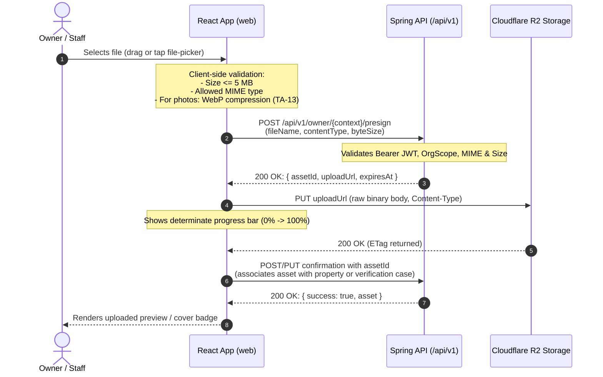

# FindStay — Photo Uploader & Document Uploader Component Specification (`S1-09-T1`)

- **Task:** [`S1-09-T1`](../scrum/sprint-01/stories/S1-09/tasks/S1-09-T1.md) (Issue [#75](https://github.com/ObboyeBossman/findstay/issues/75))
- **Story:** [`S1-09`](../scrum/sprint-01/stories/S1-09/README.md) — Photo & Document Uploads
- **Traceability:** `NFR-17` (≤ 5 MB file size limit), `NFR-24` (private verification documents), `TA-12` (direct-to-R2 architecture), `TA-13` (client-side WebP conversion), `backend-architecture.md §4.6`
- **Wireframes Referenced:** [`SCR-12-Photo-Management.png`](./wireframes/SCR-12-Photo-Management.png), [`SCR-09-10-Owner-Verification-Status.png`](./wireframes/SCR-09-10-Owner-Verification-Status.png)
- **Design Tokens:** [`web/src/theme/tokens.css`](../../web/src/theme/tokens.css) via Tailwind classes
- **Shared Components:** [`web/src/components/ui/`](../../web/src/components/ui/) (`Toast`, `InlineError`, `EmptyState`, `Skeleton`)

---

## 1. Overview & Architectural Directives

This specification defines the responsive visual layout, user interactions, direct-to-storage architecture, and complete state machine for FindStay's two core file-upload components:

1. **Photo Uploader (`PROPERTY_PHOTO`):** Listing gallery manager supporting multiple images (up to 10), client-side WebP compression, drag-and-drop or tap-to-pick dropzone, per-file upload progress, cover photo selection, reordering (mobile buttons + desktop drag), and deletion.
2. **Document Uploader (`VERIFICATION_DOCUMENT`):** Private owner verification document uploader for Ghana Cards, property ownership proof, and Ghana Tourism Authority (GTA) licences, featuring explicit privacy notices, non-public storage guarantees, and review status badges.

### Non-Negotiable Engineering Invariants
1. **Zero Browser Business Data Access to R2/Database:** Uploads never stream through the API backend server. The API validates identity, `OrgScope` (`organization_id`), and MIME/size limits, then issues a short-lived pre-signed URL. The browser PUTs raw bytes directly to Cloudflare R2 (`backend-architecture.md §4.6`).
2. **Private vs. Public Bucket Segregation:**
   - Property photos land in the **Public WebP bucket** (`R2_PUBLIC_BUCKET`) served via CDN.
   - Verification files land in the **Private bucket** (`R2_PRIVATE_BUCKET`) accessible only via short-lived signed GET URLs by authorised reviewers.
3. **No Hard-Coded Visual Values:** All colours, borders, typography, spacing, and animations strictly map to tokens in `web/src/theme/tokens.css` (guarded by `npm run lint:theme`).
4. **Mobile-First Zero-Overflow:** Responsive from **`360px`** mobile screens up to desktop with zero horizontal scroll (`overflow-x: hidden`). Touch targets satisfy `min-h-[44px]` and `min-w-[44px]`.

---

## 2. Direct-to-R2 Two-Step Direct Upload Flow



---

## 3. Photo Uploader (`PROPERTY_PHOTO`) Specification

### 3.1 Scope, Limits, & Capabilities
- **Target Contexts:** Property Add/Edit form (`SCR-11`), Photo Management (`SCR-12`).
- **Capacity:** Maximum **10 photos** per property listing (`Cap Indicator: "x of 10 photos used"`).
- **Accepted MIME Types:** `image/jpeg`, `image/png`, `image/webp`.
- **Max File Size:** `5 MB` per original raw image (`NFR-17`).
- **Client-Side Optimization (`TA-13`):** Uncompressed JPEGs/PNGs are converted to `image/webp` (quality `0.82`) on a hidden HTML5 canvas before R2 upload. A visual badge indicates `"Optimising to WebP..."` during this phase.
- **Primary / Cover Photo:** The photo in index 0 is always the primary cover photo, badged with a distinct `[Cover Photo]` pill. Any uploaded photo can be designated as the cover photo with a single tap/click.

---

### 3.2 Responsive Wireframes

#### Mobile Layout (`360px` Viewport — Zero Horizontal Scroll)

```text
+--------------------------------------+  <- 360px wide (16px outer padding)
| Photo Gallery                        |  <- font-display text-h3 text-earth
| Add up to 10 photos of your stay.    |  <- font-sans text-body-sm text-earth/70
|                                      |
| +----------------------------------+ |  <- Dashed dropzone border-border-subtle
| |        (CloudUpload Icon)        | |     bg-surface-muted/30 rounded-lg p-6
| |    Tap to upload photos          | |  <- font-display text-body-md font-medium
| |    JPEG, PNG, WebP up to 5 MB    | |  <- text-caption text-earth/60
| |                                  | |
| |  [ Select Photos from Device ]   | |  <- Button: bg-olive text-on-brand min-h-[44px]
| +----------------------------------+ |
|                                      |
| Capacity: 3 of 10 photos used        |  <- font-sans text-caption font-semibold
| [========                      ] 30% |  <- Progress track: h-1.5 bg-surface-muted
|                                      |
| +-----------------+ +---------------+|  <- 2-column grid: grid-cols-2 gap-3
| | [Cover]  [Order 1]| | [Order 2]    ||
| | +---------------+ | | +-----------+||
| | | [Image Thumb] | | | |[Img Thumb]|||
| | +---------------+ | | +-----------+||
| | Bedroom view    | | | Living room ||
| | [Set Cover]     | | | [Set Cover] ||  <- Tap controls for mobile touch targets
| | [<] [>]  [Trash]| | | [<] [>] [Tr]||  <- Min touch target 44x44px
| +-----------------+ +---------------+|
|                                      |
| +----------------------------------+ |  <- Active Uploading Tile
| | pool-sunset.jpg  (Optimising...) | |
| | [==========--------] 62%         | |  <- Determinate upload bar bg-olive
| +----------------------------------+ |
|                                      |
| [ Continue to Listing Preview ]      |  <- Primary CTA: bg-terracotta-dark
+--------------------------------------+
```

#### Desktop Layout (`1024px+` Viewport)

```text
+------------------------------------------------------------------------------------+
| Photo Management (SCR-12)                                                          |
| Upload high-quality photos. Drag to reorder; first photo is your primary cover.    |
| Capacity: 4 of 10 photos used                                                      |
+------------------------------------------------------------------------------------+
|                                                                                    |
| +--------------------------------------------------------------------------------+ |
| |                                (CloudUpload Icon)                              | |
| |          Drag and drop listing photos here, or click to browse files           | |
| |                 Supports JPEG, PNG, or WebP up to 5 MB per file                 | |
| |                                                                                | |
| |                           [ Browse Files on Computer ]                         | |
| +--------------------------------------------------------------------------------+ |
|                                                                                    |
| Photos Grid (Drag cards to reorder)                                                |
| +------------------+ +------------------+ +------------------+ +------------------+|
| | [★ Cover Photo]  | | [#2 Photo]       | | [#3 Photo]       | | [#4 Photo]       ||
| | +--------------+ | | +--------------+ | | +--------------+ | | +--------------+ ||
| | | [Img Preview]| | | | [Img Preview]| | | | [Img Preview]| | | | [Img Preview]| ||
| | +--------------+ | | +--------------+ | | +--------------+ | | +--------------+ ||
| | master-bed.webp  | | living-room.webp | | kitchen.webp     | | bathroom.webp    ||
| | 1.2 MB · WebP    | | 980 KB · WebP    | | 1.4 MB · WebP    | | 820 KB · WebP    ||
| |                  | | [Set as Cover]   | | [Set as Cover]   | | [Set as Cover]   ||
| | [Delete Photo]   | | [Delete Photo]   | | [Delete Photo]   | | [Delete Photo]   ||
| +------------------+ +------------------+ +------------------+ +------------------+|
|                                                                                    |
| [ Save & Continue to Preview ]                                                     |
+------------------------------------------------------------------------------------+
```

---

### 3.3 Photo Uploader State Machine & Feedback Specs

| State | Visual Trigger & Class Tokens | Microcopy & UI Controls | Accessibility / Behavior |
| :--- | :--- | :--- | :--- |
| **1. Empty / Idle** | `border-2 border-dashed border-border-subtle bg-surface-muted/30 hover:border-olive hover:bg-surface-hover/50 rounded-lg p-6` | "Drag & drop photos here, or tap to browse"<br/>"JPEG, PNG, WebP up to 5 MB" | File picker triggers on click/Enter. Drag event listeners on dropzone. |
| **2. Drag-Over** | `border-2 border-dashed border-olive bg-status-success-bg/40 scale-[1.01] transition-all` | "Drop photos to start uploading" | Highlighted drag target; drop handler captures `e.dataTransfer.files`. |
| **3. Client WebP Conversion** | `bg-surface-card border border-border-subtle rounded-lg p-3 flex items-center gap-3` | Spinning loader (`animate-spin text-olive`) + "Optimising to WebP..." | Image drawn to canvas, converted to WebP blob; unblocks direct R2 presign. |
| **4. Uploading (Progress)** | `bg-surface-card border border-border-subtle rounded-lg p-3`<br/>Progress bar: `h-1.5 w-full bg-surface-muted rounded-full overflow-hidden`<br/>Fill: `h-full bg-olive transition-all duration-300` | `{fileName} · {percent}%`<br/>"Uploading to storage..." + Cancel action `(X)` | `aria-valuenow="{percent}" aria-valuemin="0" aria-valuemax="100" role="progressbar"`. |
| **5. Uploaded Thumbnail** | `bg-surface-card border border-border-subtle rounded-lg overflow-hidden shadow-sm` | Thumbnail image (`aspect-[4/3] object-cover`) + Cover Badge (`bg-olive text-on-brand`) + order index badge | Drag handle with grab cursor on desktop; tap `Move Left` / `Move Right` on mobile. |
| **6. Capacity Limit (10/10)** | `border border-border-subtle bg-surface-muted/60 p-4 rounded-lg opacity-75` | "Maximum limit reached (10 of 10 photos). Remove a photo to upload more." | Upload button disabled (`cursor-not-allowed`). Drag-drop rejects extra files with Toast. |
| **7. Error: Oversized (> 5 MB)** | `border border-status-error-border bg-status-error-bg/60 p-3 rounded-md text-status-error-fg flex items-start gap-2` | AlertCircle icon + "File '{name}' exceeds 5 MB limit ({size}). Please choose a smaller image." | File rejected before network request; Toast + InlineError rendered. |
| **8. Error: Invalid Type** | `border border-status-error-border bg-status-error-bg/60 p-3 rounded-md text-status-error-fg` | AlertCircle icon + "Unsupported format. Only JPEG, PNG, and WebP images are allowed." | Non-image files filtered out immediately. |
| **9. Error: Network / Storage Failure** | Card error overlay: `bg-status-error-bg/90 p-3 rounded-lg flex flex-col items-center gap-2` | "Upload failed. Check your internet connection."<br/>[ Retry Upload ] [ Remove ] | Retry button re-executes presign + PUT pipeline; remove discards failed card. |

---

## 4. Document Uploader (`VERIFICATION_DOCUMENT`) Specification

### 4.1 Scope, Privacy, & Verification Directives
- **Target Contexts:** Owner Verification form (`SCR-09`), Verification Status page (`SCR-10`).
- **Required Document Slots:**
  1. **Ghana Card (Front & Back):** Personal identity verification of the property manager / owner.
  2. **Proof of Ownership / Right to Host:** Indenture, Land Title Certificate, leasehold contract, or recent utility bill in the owner's name.
  3. **Ghana Tourism Authority (GTA) Licence:** Accommodation permit or operating licence (where applicable).
- **Accepted MIME Types:** `application/pdf`, `image/jpeg`, `image/png`.
- **Max File Size:** `5 MB` per document (`NFR-17`).
- **Privacy & Protection (`NFR-24`, `NFR-28`):**
  - Stored strictly in the **Private R2 Bucket**.
  - Must display the verified security callout:
    > **🔒 Stored privately:** Verification documents are encrypted and accessible only by authorised FindStay verification officers. They are never published, shared with guests, or indexed by search engines.

---

### 4.2 Responsive Wireframes

#### Mobile Layout (`360px` Viewport)

```text
+--------------------------------------+  <- 360px wide (16px padding)
| Identity & Property Verification     |  <- font-display text-h3 text-earth
| Upload official verification papers. |  <- font-sans text-body-sm text-earth/70
|                                      |
| +----------------------------------+ |  <- Privacy Callout: bg-surface-muted
| | [Lock] Stored Privately          | |     border border-border-subtle p-3
| | Documents are encrypted and only | |     text-caption text-earth/80
| | visible to authorized reviewers. | |
| +----------------------------------+ |
|                                      |
| 1. Ghana Card (Required)             |  <- font-display text-body-md font-semibold
| [ Uploaded & Verified ✓ ]            |  <- Badge: bg-status-success-bg text-status-success-fg
| +----------------------------------+ |
| | [PDF Icon] ghana-card-front.pdf  | |  <- Preview card: bg-surface-card
| | 1.8 MB · Uploaded 24 Nov 2026    | |     border border-border-subtle p-3
| | [ Replace File ]   [ Remove ]    | |  <- Touch targets min-h-[44px]
| +----------------------------------+ |
|                                      |
| 2. Proof of Ownership (Required)     |
| [ Action Required: Needs Resubmit ]  |  <- Badge: bg-status-error-bg text-status-error-fg
| +----------------------------------+ |  <- Error note from admin reviewer
| | [!] Document unreadable. Please  | |     border-l-4 border-status-error-border
| | upload a clear photo or PDF.     | |
| +----------------------------------+ |
| | +------------------------------+ | |  <- Empty upload dropzone
| | | Tap to upload title / deed   | | |
| | | PDF, PNG, JPG up to 5 MB     | | |
| | | [ Choose File ]              | | |
| | +------------------------------+ | |
| +----------------------------------+ |
|                                      |
| 3. GTA Licence (Optional)            |
| [ Not Uploaded ]                     |  <- Badge: bg-surface-muted text-earth/70
| +----------------------------------+ |
| | Tap to upload GTA permit (PDF)   | |
| | [ Choose File ]                  | |
| +----------------------------------+ |
|                                      |
| [ Submit Verification Documents ]    |  <- Primary Action: bg-olive text-on-brand
+--------------------------------------+
```

#### Desktop Layout (`1024px+` Viewport)

```text
+------------------------------------------------------------------------------------+
| Owner Verification Documents (SCR-09 / SCR-10)                                     |
| Submit your government-issued credentials to receive the FindStay Verified badge.  |
|                                                                                    |
| [🔒 Security Guarantee: Uploads land in private encrypted storage (NFR-24/28)]      |
+------------------------------------------------------------------------------------+
|                                                                                    |
| Document Checklist & Upload Slots                                                  |
|                                                                                    |
| +--------------------------------------------------------------------------------+ |
| | 1. Ghana National ID Card                                      [ Approved ✓ ]  | |
| | Front and back view of your biometric Ghana Card.                              | |
| |                                                                                | |
| | +----------------------------------------------------------------------------+ | |
| | | [PDF Icon]  ghana_card_abraham.pdf        1.4 MB · Uploaded Nov 24, 2026   | | |
| | |             Status: Verified by Admin     [ View Document ] [ Replace ]    | | |
| | +----------------------------------------------------------------------------+ | |
| +--------------------------------------------------------------------------------+ |
|                                                                                    |
| +--------------------------------------------------------------------------------+ |
| | 2. Proof of Ownership or Lease Agreement                  [ Needs Review ⏳ ]  | |
| | Official land commission title, indenture, or valid tenancy agreement.         | |
| |                                                                                | |
| | +----------------------------------------------------------------------------+ | |
| | |                               (FileUp Icon)                                | | |
| | |         Drag and drop your PDF or image here, or browse files              | | |
| | |                     PDF, JPEG, or PNG up to 5 MB                           | | |
| | |                               [ Select Document ]                          | | |
| | +----------------------------------------------------------------------------+ | |
| +--------------------------------------------------------------------------------+ |
|                                                                                    |
| +--------------------------------------------------------------------------------+ |
| | 3. Ghana Tourism Authority (GTA) Licence                          [ Optional ] | |
| | Accommodation facility operating licence issued by the GTA.                    | |
| |                                                                                | |
| | +----------------------------------------------------------------------------+ | |
| | | [Upload Dropzone...]                                                       | | |
| | +----------------------------------------------------------------------------+ | |
| +--------------------------------------------------------------------------------+ |
|                                                                                    |
| [ Save Verification Progress ]       [ Submit All for Administrator Review ]       |
+------------------------------------------------------------------------------------+
```

---

### 4.3 Document Uploader State Machine & Status Badges

| State | Visual Tokens & Card Style | Controls & Actions | Verification Semantics |
| :--- | :--- | :--- | :--- |
| **Empty Slot** | `border-2 border-dashed border-border-subtle bg-surface-muted/30 p-6 rounded-lg text-center` | Tap / Click to open file picker (`accept=".pdf,image/png,image/jpeg"`) | Initial state for unsubmitted document slot. |
| **Uploading** | `border border-border-subtle bg-surface-card p-4 rounded-lg`<br/>Progress: `h-1.5 bg-olive` | File icon + name + percent counter + Cancel `(X)` | Direct R2 `PUT` underway. Prevents page navigation during upload. |
| **Uploaded / Pending** | `border border-border-subtle bg-surface-card p-4 rounded-lg flex items-center justify-between` | File icon (`FileText`) + filename + size + date.<br/>Badge: `bg-status-warning-bg text-status-warning-fg border-status-warning-border` ("Pending Review") | Awaiting admin inspection in `SCR-20`. |
| **Approved / Verified** | `border border-status-success-border bg-status-success-bg/20 p-4 rounded-lg` | Badge: `bg-status-success-bg text-status-success-fg border-status-success-border` ("Verified ✓")<br/>View Document CTA (signed GET). | Locked from editing unless unlocked by administrator. |
| **Action Required / Correction** | `border border-status-error-border bg-status-error-bg/30 p-4 rounded-lg` | Badge: `bg-status-error-bg text-status-error-fg border-status-error-border` ("Corrections Needed")<br/>Feedback box with reviewer note + `[ Replace Document ]`. | Rejection feedback from `SCR-20` review decision. User uploads new file. |
| **File Error (Oversized / Type)** | `bg-status-error-bg/60 border border-status-error-border p-3 rounded-md text-status-error-fg` | Inline error message + Clear error CTA. | Rejects files > 5 MB or outside `.pdf`, `.jpg`, `.png`. |

---

## 5. Design System Tokens & Class Alignment

All styling directly maps to existing design tokens defined in [`web/src/theme/tokens.css`](../../web/src/theme/tokens.css):

### 5.1 Color Tokens Applied

| Semantic Role | Tailwind Class | Underlying Token & Hex Value | Purpose |
| :--- | :--- | :--- | :--- |
| **Canvas / Background** | `bg-canvas` | `--color-canvas` (`#ffffff`) | Page backdrop |
| **Card Surface** | `bg-surface-card` | `--color-surface-card` (`#ffffff`) | Upload preview tiles, dropzone panels |
| **Muted Surface / Tracks** | `bg-surface-muted` | `--color-surface-muted` (`#efeae0`) | Dropzone background, progress bar tracks |
| **Borders** | `border-border-subtle` | `--color-border-subtle` (`#d6cdbd`) | Control borders, card outlines |
| **Brand Primary Actions** | `bg-olive` / `hover:bg-olive-hover` | `--color-olive` (`#2e6f40`) | Dropzone CTAs, progress bar fill, cover badge |
| **Brand Text on Brand** | `text-on-brand` | `--color-on-brand` (`#ffffff`) | Text on olive and terracotta buttons |
| **Primary Typography** | `text-earth` | `--color-earth` (`#4a2c1d`) | Headings, primary labels |
| **Secondary Typography** | `text-earth/70` | `--color-earth` with opacity | Descriptions, file sizes, helper notes |
| **Success Status** | `bg-status-success-bg text-status-success-fg border-status-success-border` | Success token suite | Verified document badge, upload completion |
| **Warning Status** | `bg-status-warning-bg text-status-warning-fg border-status-warning-border` | Warning token suite | Pending review badge, capacity warnings |
| **Error Status** | `bg-status-error-bg text-status-error-fg border-status-error-border` | Error token suite | Oversized file banner, failed upload, rejection note |

### 5.2 Shared Feedback Component Integration (`S1-03-T5`)
- **`Toast`:** Used for transient notifications (`"Photo uploaded successfully"`, `"Cannot exceed 10 photos"`, `"Network connection lost"`).
- **`InlineError` (`FormField`):** Used beneath dropzones when a form submission is blocked due to missing required documents (e.g. `"Ghana Card is required to submit verification"`).
- **`Skeleton`:** Displayed when fetching existing property photos or document review statuses during initial page load.

---

## 6. Implementation Checklist for Frontend Engineers (`S1-09-T6`)

When building the React components in `web/src/components/upload/` during `S1-09-T6`:

- [ ] Create `PhotoUploader.tsx` supporting `maxPhotos={10}`, drag-and-drop, client WebP canvas compression (`TA-13`), and reordering.
- [ ] Create `DocumentUploader.tsx` supporting PDF/image previews, privacy badge display (`NFR-24`), and replace/remove callbacks.
- [ ] Implement `useDirectUpload` hook handling two-step presign (`POST .../presign`) -> direct `XMLHttpRequest` or `fetch` `PUT` to Cloudflare R2 with progress calculation -> confirmation call.
- [ ] Enforce mobile-first zero-overflow: `overflow-x: hidden`, min touch targets `44px × 44px`.
- [ ] Guard styling with `npm run lint:theme` to ensure zero hard-coded colours, lengths, or fonts.
