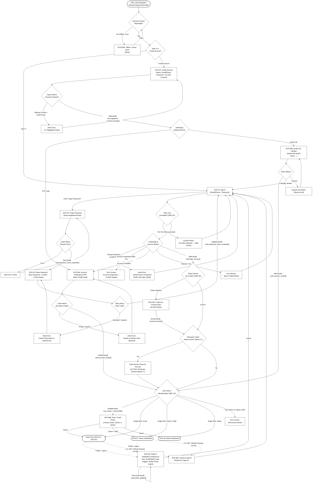
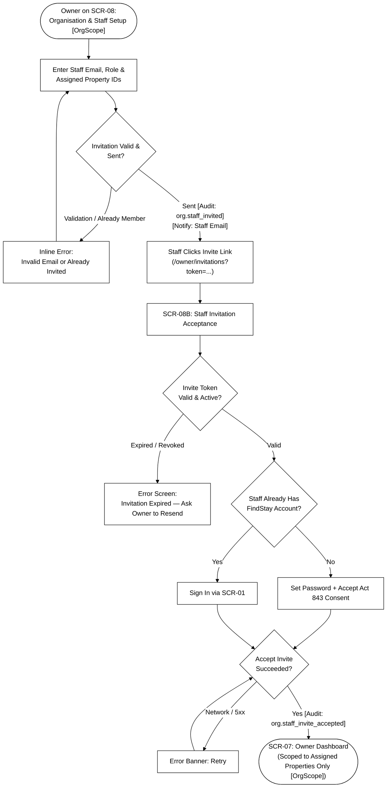
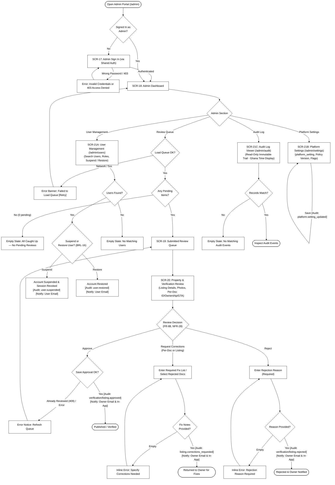
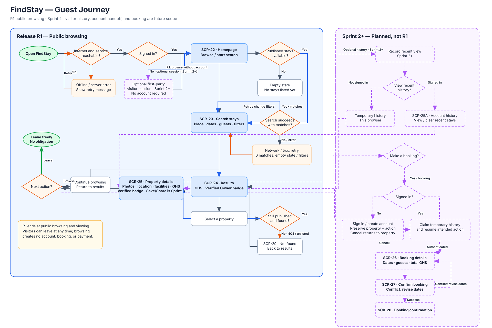

# FindStay — User Flow Diagrams & Screen Specification (`S1-01-T3`)

- **Task:** [`S1-01-T3`](../scrum/sprint-01/stories/S1-01/tasks/S1-01-T3.md) (Issue [#27](https://github.com/ObboyeBossman/findstay/issues/27))
- **Story:** [`S1-01`](../scrum/sprint-01/stories/S1-01/README.md) — Project Setup & System Design
- **Author:** Anthony Maclean (`@dztrb`)
- **Status:** Draft (pending `S1-01-T1` confirmation & team review)

This document is the screen-to-screen blueprint for Sprint 1 and the direct input to **T4 (Wireframes)**, **T6 (API Contracts)**, **T8 (Database ERD)**, and **T13 (Test Plan)**.

---

## Sprint 1 vs. Later Sprints Legend

| Marker | Meaning |
| :--- | :--- |
| **Sprint 1** (default) | Built and shipped in Phase 1, Release `R1` (Foundation, Auth, Org/Staff, Verification, Catalog, Calendar, Admin Review & Audit). |
| **`[Sprint 2+]`** | Deferred beyond `R1` (Guest-session continuity, recently viewed history, booking, checkout, payments, "Booked" calendar state). Drawn only to show end-to-end continuity. |
| **`[Sprint 3]`** | Future enhancement stub (e.g., Guest save/share property). |
| **`[Audit: event_name]`** | Action writes an immutable record to `audit.audit_log` (`BRL-13`, `BRL-16`, `NFR-66`). |
| **`[Notify: target]`** | Action triggers a `NotificationSender` event (`FR-66..71`, `BRL-17`). |
| **`[OrgScope]`** | Enforces `organization_id` tenant isolation (`BRL-04`, `UR-ON02`). |

> [!NOTE]
> **Money & Timezone Conventions (`NFR-08`, `NFR-52`):** All prices are **displayed in GHS** and **stored as integer pesewas**. All timestamps are **stored in UTC/GMT** and **formatted for `Africa/Accra` (Ghana time)** at presentation boundaries.

---

## 1. Numbered Screen Inventory (Input for `T4`, `T6`, `T8`)

| ID | Screen Name | Story | Scope | API Endpoint (`/api/v1/...`) | Audit Event (`audit.audit_log`) | Mobile (`360px+`) & Desktop Variant | One-Line Purpose |
| :--- | :--- | :---: | :---: | :--- | :--- | :--- | :--- |
| **SCR-01** | Sign In | `S1-04` | Sprint 1 | `POST /api/v1/auth/session` (Supabase + `/me`) | `auth.login_success` / `auth.login_failed` | Single-column card (mobile) / Centered split card (desktop) | Authenticate Guest, Owner, Staff, or Admin with email/phone and password. |
| **SCR-02** | Create Account | `S1-04` | Sprint 1 | `POST /api/v1/auth/register` + `POST /api/v1/consents` | `user.registered`, `consent.recorded` | Vertical stacked form (mobile) / Centered card (desktop) | Register account and capture Ghana Act 843 privacy consent (`S1-11`). |
| **SCR-03A** | Account Verification (OTP) | `S1-04` | Sprint 1 | `POST /api/v1/auth/verify-otp` | `auth.account_verified` | Large 6-digit OTP inputs (mobile) / Centered card (desktop) | Enter email/SMS OTP code after sign-up to activate account. |
| **SCR-03B** | Email Verification Link Landing | `S1-04` | Sprint 1 | `GET /api/v1/auth/verify-email?token=...` | `auth.account_verified` | Full-screen status card + icon (mobile & desktop) | Handle email-link click: Verified / Already Verified / Expired Link (`[Resend]`). |
| **SCR-04** | Forgot Password | `S1-05` | Sprint 1 | `POST /api/v1/auth/password-reset/request` | `auth.password_reset_requested` | Single-input card (mobile & desktop) | Request password-reset email/OTP by entering registered email. |
| **SCR-05** | Reset Password | `S1-05` | Sprint 1 | `POST /api/v1/auth/password-reset/confirm` | `auth.password_reset_completed` | Form + inline password-policy checklist (mobile & desktop) | Enter and confirm new password meeting policy rules. |
| **SCR-06** | Profile & Notification Preferences | `S1-05`, `S1-10` | Sprint 1 | `GET/PATCH /api/v1/me`, `GET/PUT /api/v1/me/notifications/preferences` | `user.profile_updated` | Tabbed sections + bottom nav (mobile) / Left sidebar + form (desktop) | Update `/me` profile, toggle Email/SMS/In-App preferences, and **Logout**. |
| **SCR-06B** | Role / Portal Picker | `S1-06` | Sprint 1 | `GET /api/v1/me` (roles & memberships) | — | Stacked role cards with icons (mobile) / Grid cards (desktop) | Let multi-role users (Guest + Owner + Staff) pick or switch active portal (`BRL-02`). |
| **SCR-06C** | Policy Re-Consent Gate | `S1-11` | Sprint 1 | `GET /api/v1/consents/latest`, `POST /api/v1/consents` | `consent.recorded` | Full-screen modal sheet (mobile) / Centered dialog (desktop) | Block entry until user reviews and accepts updated `policy_version` (`NFR-36`). |
| **SCR-06D** | Session Expired Redirect | `S1-04` | Sprint 1 | — (401 / refresh failure) | `auth.session_expired` | Banner + redirect to `SCR-01` (mobile & desktop) | Inform user 1-hr JWT/refresh expired mid-task and return to `SCR-01` (`TA-08`). |
| **SCR-07** | Owner Dashboard | `S1-07` | Sprint 1 | `GET /api/v1/owner/dashboard` `[OrgScope]` | — | Summary cards + icon nav bar (mobile) / Sidebar + KPI grid (desktop) | Owner/staff home showing org verification status, listing counts, and alerts. |
| **SCR-07B** | Owner Listings List (`/owner/listings`) | `S1-13` | Sprint 1 | `GET /api/v1/owner/properties` `[OrgScope]` | — | Card list + status badges (mobile) / Table + filter bar (desktop) | Entry list of all org properties with status, quick preview, pause/activate actions. |
| **SCR-08** | Organisation & Staff Setup | `S1-07` | Sprint 1 | `GET/PATCH /api/v1/owner/org`, `POST /api/v1/owner/invitations` `[OrgScope]` | `org.staff_invited`, `org.staff_role_updated` | Stacked org card + invite sheet (mobile) / Two-column layout (desktop) | Manage company space (`organization_id`) and invite staff scoped to properties. |
| **SCR-08B** | Staff Invitation Acceptance (`/owner/invitations`) | `S1-07` | Sprint 1 | `GET /api/v1/invitations/{token}`, `POST /api/v1/invitations/{token}/accept` | `org.staff_invite_accepted` | Single-column onboarding card (mobile & desktop) | Invited staff views org + assigned properties, sets password, and joins org. |
| **SCR-09** | Owner Verification Upload | `S1-12` | Sprint 1 | `POST /api/v1/owner/verification/presign`, `POST /api/v1/owner/verification/submit` `[OrgScope]` | `verification.submitted` | Step-by-step per-doc upload cards (mobile) / 3-doc grid (desktop) | Upload Ghana Card, ownership proof, and GTA licence (or re-upload single rejected doc). |
| **SCR-10** | Owner Verification Status | `S1-12` | Sprint 1 | `GET /api/v1/owner/verification` `[OrgScope]` | — | Per-document status cards with icons/text (mobile & desktop) | Show overall and **per-document** status (`Pending`, `Approved`, `Rejected` + fix note). |
| **SCR-11** | Add / Edit Property Form | `S1-13` | Sprint 1 | `POST /api/v1/owner/properties`, `PATCH /api/v1/owner/properties/{id}` `[OrgScope]` | `listing.draft_saved`, `listing.paused`, `listing.reactivated` | Multi-step accordion + auto-save badge (mobile) / Two-column form (desktop) | Edit property details, location, amenities, rules, and pause/deactivate listing. |
| **SCR-11B** | Multi-Unit Editor | `S1-13` | Sprint 1 | `POST/PATCH/DELETE /api/v1/owner/properties/{id}/units` `[OrgScope]` | `unit.created`, `unit.updated` | Unit card list + bottom sheet editor (mobile) / Inline table + drawer (desktop) | Add/edit individual units (`unit_id`) with own pesewa rate and billing period (`P-02`). |
| **SCR-11C** | Listing Preview | `S1-13` | Sprint 1 | `GET /api/v1/owner/properties/{id}/preview`, `POST .../submit` `[OrgScope]` | `listing.submitted` | Mobile guest-view preview + `[Submit]` sticky bar (mobile & desktop) | Preview listing as guests will see it before submitting for admin review. |
| **SCR-12** | Photo Management | `S1-09` | Sprint 1 | `POST /api/v1/owner/properties/{id}/photos/presign`, `PUT/DELETE .../photos` `[OrgScope]` | `listing.photos_updated` | 2-column photo grid + reorder/cover/delete (mobile) / 4-col grid (desktop) | Upload WebP photos (max 10), reorder, set cover photo, replace, or delete (`FR-14`). |
| **SCR-13** | Property Submission Status | `S1-13` | Sprint 1 | `GET /api/v1/owner/properties/{id}` `[OrgScope]` | — | Status timeline + correction list (mobile & desktop) | Show `Draft`, `Pending Review`, `Corrections Requested`, `Approved`, or `Rejected`. |
| **SCR-14** | Manage Property & Units | `S1-13` | Sprint 1 | `GET /api/v1/owner/properties/{id}` `[OrgScope]` | — | Summary header + action list (mobile) / Tabs: Overview, Units, Calendar (desktop) | Central property management hub: edit, pause/activate, open unit calendar. |
| **SCR-15** | Unit Availability Calendar | `S1-14` | Sprint 1 | `GET /api/v1/owner/units/{unitId}/availability` `[OrgScope]` | — | Month grid with colour+pattern legend (mobile & desktop) | View unit calendar: `Available` / `Owner-Blocked` (`Booked` is `[Sprint 2+]`). |
| **SCR-16** | Block / Unblock Dates Form | `S1-14` | Sprint 1 | `POST/DELETE /api/v1/owner/units/{unitId}/blocks` `[OrgScope]` | `availability.block_created`, `availability.block_removed` | Bottom-sheet date picker (mobile) / Side panel form (desktop) | Create, edit, or remove owner date-range blocks (`btree_gist` conflict check). |
| **SCR-17** | Admin Sign In | `S1-04` | Sprint 1 | `POST /api/v1/auth/session` (Admin role check) | `auth.admin_login` | Centered card (mobile & desktop) | Authenticate platform administrator into `/admin`. |
| **SCR-18** | Admin Dashboard | `S1-16` | Sprint 1 | `GET /api/v1/admin/dashboard` | — | KPI stack + icon nav (mobile) / Sidebar + KPI cards (desktop) | Overview of pending verification/listing queues, user stats, and recent alerts. |
| **SCR-19** | Submitted Review Queue | `S1-15` | Sprint 1 | `GET /api/v1/admin/reviews?status=pending` | — | Queue cards with age badge (mobile) / Filterable table (desktop) | List pending owner verifications and property submissions awaiting review. |
| **SCR-20** | Property & Verification Review | `S1-15` | Sprint 1 | `GET /api/v1/admin/reviews/{id}`, `POST .../decision` | `verification.approved/rejected`, `listing.approved/corrections/rejected` | Stacked sections + sticky decision bar (mobile) / Split pane (desktop) | Inspect listing, photos, and per-doc verification; **Approve / Request Corrections / Reject**. |
| **SCR-21A** | User Management (`/admin/users`) | `S1-16` | Sprint 1 | `GET /api/v1/admin/users`, `POST /api/v1/admin/users/{id}/suspend\|restore` | `user.suspended`, `user.restored` | User card list + action sheet (mobile) / Searchable table (desktop) | Search users, view roles, and suspend or restore accounts (`BRL-16`, `FR-87`). |
| **SCR-21B** | Platform Settings (`/admin/settings`) | `S1-16` | Sprint 1 | `GET/PATCH /api/v1/admin/settings` | `platform.setting_updated` | Stacked setting groups (mobile) / Categorized form (desktop) | Configure platform settings (`platform_setting`), policy version, and feature flags. |
| **SCR-21C** | Audit Log Viewer (`/admin/audit`) | `S1-08` | Sprint 1 | `GET /api/v1/admin/audit-logs` | — (read-only) | Compact event cards (mobile) / Filterable log table (desktop) | Inspect immutable `audit.audit_log` entries (actor, action, target, UTC/Ghana time). |
| **SCR-22** | Homepage (Browse & Search) | `S1-03` | Sprint 1 | `GET /api/v1/properties/featured` | — | Search bar + 1-col cards + icon nav (mobile) / Hero search + 3-col grid (desktop) | Public landing page where guests browse featured listings and start searching. |
| **SCR-23** | Search Accommodation | `S1-03` | Sprint 1 | `GET /api/v1/properties/search` | — | Full-screen filter sheet (mobile) / Top bar + left filter sidebar (desktop) | Enter destination, dates, guests, and filters. |
| **SCR-24** | Search Results | `S1-03` | Sprint 1 | `GET /api/v1/properties/search` | — | 1-col listing cards + Verified badge (mobile) / 2–3-col grid + map/sort (desktop) | Display matching available properties with GHS price and Verified Owner badge. |
| **SCR-25** | Property Details | `S1-13` | Sprint 1 | `GET /api/v1/properties/{id}` | — | Photo carousel + sticky CTA bar (mobile) / Gallery + 2-col layout (desktop) | Show photos, GHS price, **Verified Owner badge**, facilities, and Save/Share `[Sprint 3]` stub. |
| **SCR-25A** | Recently Viewed (`/recently-viewed`) | `S2+` | Sprint 2+ | `GET /api/v1/me/recently-viewed`, `DELETE /api/v1/me/recently-viewed` | — | Recent-property cards + clear-history action (mobile) / Filterable history grid (desktop) | Let a signed-in user revisit properties first viewed during an anonymous or authenticated session. |
| **SCR-26** | Booking Details `[Sprint 2+]` | `S2+` | Sprint 2+ | `POST /api/v1/bookings/draft` `[Sprint 2+]` | — | Single-column form (mobile) / 2-col form + price summary (desktop) | Enter/confirm stay dates, guests, and contact info. |
| **SCR-27** | Confirm Booking `[Sprint 2+]` | `S2+` | Sprint 2+ | `POST /api/v1/bookings` `[Sprint 2+]` | `booking.created` `[Sprint 2+]` | Summary + confirm CTA (mobile & desktop) | Review booking summary and confirm reservation/payment. |
| **SCR-28** | Booking Confirmation `[Sprint 2+]` | `S2+` | Sprint 2+ | `GET /api/v1/bookings/{id}` `[Sprint 2+]` | — | Confirmation card + receipt download (mobile & desktop) | Display confirmed booking reference and summary. |
| **SCR-29** | 404 Not Found | `S1-03` | Sprint 1 | — | — | Centered icon + `[Go Home]` (mobile & desktop) | Shown when a route or property ID does not exist. |
| **SCR-ERR** | Global Offline / Server Error | `S1-03` | Sprint 1 | — | — | Centered icon + clear, simple message + `[Retry]` | Shown when offline or API returns `5xx`. |

---

## 2. Shared Flow: Authentication, Consent, Role Picker & Session Lifecycle

Covers **`S1-04`**, **`S1-05`**, **`S1-06`**, **`S1-10`**, **`S1-11`**. Drawn once and referenced by all portals.

---

## 3. Staff Onboarding Flow (`S1-07` — `FR-09`, `UR-O15`, `UR-PM03`, `UR-PS01`)

Covers inviting staff, accepting an invitation at `/owner/invitations`, setting a password, and entering the owner portal scoped to assigned properties `[OrgScope]`.

---

## 4. Property Owner Journey (`S1-07`, `S1-09`, `S1-12`, `S1-13`, `S1-14`)

All `/owner/*` routes enforce **`[OrgScope]`** (`organization_id` tenant isolation).

```mermaid
%%{init: {'theme': 'base', 'themeVariables': { 'primaryColor': '#ffffff', 'primaryTextColor': '#000000', 'primaryBorderColor': '#000000', 'lineColor': '#000000', 'secondaryColor': '#ffffff', 'tertiaryColor': '#ffffff', 'background': '#ffffff', 'nodeBkg': '#ffffff', 'nodeBorder': '#000000', 'clusterBkg': '#ffffff', 'clusterBorder': '#000000', 'edgeLabelBackground': '#ffffff', 'textColor': '#000000' }}}%%
flowchart TD
    Start(["Open Owner Portal (/owner)"]) --> AuthCheck{"Signed In as<br/>Owner / Staff?"}
    AuthCheck -- "No" --> SharedAuth(["Shared Auth Flow (SCR-01..SCR-06D)"]) --> SCR07
    AuthCheck -- "Yes" --> SCR07["SCR-07: Owner Dashboard [OrgScope]"]

    SCR07 --> OrgMenu["SCR-08: Organisation & Staff Setup [OrgScope]"]
    SCR07 --> VerifCheck{"Owner Verification<br/>Status? (S1-12)"}

    %% Per-Document Verification (S1-12, NFR-28)
    VerifCheck -- "Not Submitted" --> SCR09["SCR-09: Owner Verification Upload [OrgScope]<br/>(Ghana Card, Ownership Proof, GTA Licence)"]
    SCR09 --> VerifUpOK{"Upload & Submit<br/>Succeeded?"}
    VerifUpOK -- "File Too Large /<br/>Bad Format / Timeout" --> ErrVerif["Upload Error: Retry Document"]
    ErrVerif --> SCR09
    VerifUpOK -- "Yes [Audit: verification.submitted]<br/>[Notify: Admin Inbox & Email]" --> SCR10["SCR-10: Owner Verification Status [OrgScope]<br/>(Per-Doc Status: Ghana Card / Ownership / GTA)"]

    VerifCheck -- "Pending / Partial Rejection" --> SCR10
    SCR10 -- "Doc Rejected (Re-upload Rejected Doc Only)" --> SCR09
    SCR10 -- "All Docs Approved" --> SCR07B

    %% Listings Entry & Lifecycle (FR-13)
    VerifCheck -- "Approved" --> SCR07B["SCR-07B: Owner Listings List (/owner/listings) [OrgScope]"]
    SCR07B --> HasListings{"Any Properties<br/>in Organisation?"}
    HasListings -- "No (0 listings)" --> EmptyList["Empty State: No Properties Yet<br/>[+ Add Your First Property]"]
    EmptyList --> SCR11

    HasListings -- "Yes" --> ListAction{"Owner Action"}
    ListAction -- "Pause / Deactivate /<br/>Re-activate (FR-13)" --> ToggleState{"Update Listing<br/>State OK?"}
    ToggleState -- "Error" --> ErrToggle["Error Banner: Retry"]
    ToggleState -- "Yes [Audit: listing.paused / listing.reactivated]" --> SCR07B

    %% Property + Multi-Unit + Photo + Preview Flow
    ListAction -- "Add or Edit Property" --> SCR11["SCR-11: Add / Edit Property Form [OrgScope]<br/>(Details, Amenities, Rules · Draft Auto-Save)"]
    SCR11 --> PropOK{"Required Fields<br/>Valid?"}
    PropOK -- "Validation Error" --> ErrProp["Inline Error: Fix Highlighted Fields"]
    ErrProp --> SCR11

    PropOK -- "Yes" --> SCR11B["SCR-11B: Multi-Unit Editor [OrgScope] (P-02)<br/>(Add/Edit Units, Price in GHS / Stored Pesewas, Billing Period)"]
    SCR11B --> UnitOK{"At Least 1 Valid<br/>Unit?"}
    UnitOK -- "Invalid Rate / Missing Unit" --> ErrUnit["Inline Error: Add Valid Unit & Pesewa Rate"]
    ErrUnit --> SCR11B

    UnitOK -- "Yes" --> SCR12["SCR-12: Photo Management [OrgScope] (FR-14)<br/>(Upload WebP, Reorder, Set Cover, Replace, Delete · Max 10)"]
    SCR12 --> ImgOK{"Photos Valid<br/>(<= 10, WebP/Size OK)?"}
    ImgOK -- "Cap Exceeded / Upload Fail" --> ErrImg["Upload Error: Check Limit/Format [Retry]"]
    ErrImg --> SCR12

    ImgOK -- "Yes [Audit: listing.photos_updated]" --> SCR11C["SCR-11C: Listing Preview [OrgScope]<br/>(Guest-View Preview before Submit)"]
    SCR11C --> SubmitProp{"Submit Property<br/>for Review?"}
    SubmitProp -- "Concurrent Admin Review (409)" --> ErrLock["Conflict Error: Listing Locked Under Active Review"]
    ErrLock --> SCR13
    SubmitProp -- "Network / 5xx" --> ErrSub["Error Banner: Submission Failed [Retry]"]
    ErrSub --> SCR11C
    SubmitProp -- "Yes [Audit: listing.submitted]<br/>[Notify: Admin Inbox]" --> SCR13["SCR-13: Property Submission Status [OrgScope]<br/>(Pending Review / Corrections / Approved / Rejected)"]

    SCR13 -- "Corrections Requested / Rejected" --> SCR11
    SCR13 -- "Approved" --> SCR14

    %% Manage Property & Availability Calendar (S1-14)
    ListAction -- "Manage Property" --> SCR14["SCR-14: Manage Property & Units [OrgScope]"]
    SCR14 --> ManageChoice{"Action"}
    ManageChoice -- "View Bookings [Sprint 2+]" --> EmptyBook["Empty State / Bookings List [Sprint 2+]"]
    ManageChoice -- "Availability Calendar" --> SCR15["SCR-15: Unit Availability Calendar [OrgScope]<br/>(Available / Owner-Blocked · 'Booked' is [Sprint 2+])"]
    SCR15 --> CalLoad{"Calendar Loaded?"}
    CalLoad -- "Error" --> ErrCal["Error Banner: Retry"]
    ErrCal --> SCR15
    CalLoad -- "Yes" --> SCR16["SCR-16: Block / Unblock Dates Form [OrgScope]<br/>(Start/End Date in Ghana Time / Stored UTC)"]
    SCR16 --> CalSave{"Save Block OK?"}
    CalSave -- "Overlap Conflict (409 btree_gist)" --> ErrOverlap["Conflict Error: Dates Overlap Existing Block"]
    ErrOverlap --> SCR16
    CalSave -- "Invalid Range" --> ErrRange["Inline Error: End Date Must Follow Start Date"]
    ErrRange --> SCR16
    CalSave -- "Saved [Audit: availability.block_created/removed]" --> SCR15
```

---

## 5. Administrator Journey (`S1-08`, `S1-15`, `S1-16`)

Covers **Admin Review Queue** (with 3-way **Approve / Request Corrections / Reject** and **Per-Document Verification**), **User Management (Suspend/Restore)**, **Platform Settings**, and **Audit Log Viewer**.

---

## 6. Guest Journey (Anonymous Browsing, Account Handoff & Booking)

Covers **Browse & Search (`SCR-22` – `SCR-25`)** in Sprint 1 (including **Verified Owner badge** on `SCR-25` and **Save/Share `[Sprint 3]`** stub), **Shared Auth (`SCR-01` – `SCR-06D`)**, and the **`[Sprint 2+]` temporary visitor session, recently viewed history, account handoff, and booking flow**.

> [!NOTE]
> **Product Owner clarification (2026-11-16):** A person may browse public accommodations without registering or signing in. FindStay may keep low-risk browsing continuity in a temporary, first-party visitor session. If the person later authenticates, the system claims that session's recently viewed properties for the account and returns the person to the page or protected action they were using. Leaving or cancelling authentication creates no account, booking, or payment obligation.

Editable source: [guest-journey.drawio](../diagrams/guest-journey.drawio). The detailed Mermaid flow below remains the contract reference for individual branches and screen IDs.

```mermaid
%%{init: {'theme': 'base', 'themeVariables': { 'primaryColor': '#ffffff', 'primaryTextColor': '#000000', 'primaryBorderColor': '#000000', 'lineColor': '#000000', 'secondaryColor': '#ffffff', 'tertiaryColor': '#ffffff', 'background': '#ffffff', 'nodeBkg': '#ffffff', 'nodeBorder': '#000000', 'clusterBkg': '#ffffff', 'clusterBorder': '#000000', 'edgeLabelBackground': '#ffffff', 'textColor': '#000000' }}}%%
flowchart TD
    Start(["1. Open Application"]) --> NetCheck{"Internet & Server<br/>Reachable?"}
    NetCheck -- "No (Offline / 5xx)" --> SCRERR["SCR-ERR: Offline / Server Down [Retry]"]
    SCRERR -- "Retry" --> NetCheck

    NetCheck -- "Yes" --> SignedAtEntry{"Already<br/>Signed In?"}
    SignedAtEntry -- "No (R1 browsing)" --> SCR22["2. SCR-22: Homepage (Browse & Search)"]
    SignedAtEntry -- "Yes" --> SCR22
    SignedAtEntry -. "Optional continuity [Sprint 2+]" .-> VisitorSession["Temporary Visitor Session<br/>(Secure First-Party Cookie · No Account)"]
    SCR22 --> HomeEmpty{"Any Published<br/>Properties?"}
    HomeEmpty -- "No" --> EmptyHome["Empty State: No Accommodations Listed Yet"]
    HomeEmpty -- "Yes" --> SCR23["3. SCR-23: Search Accommodation<br/>(Location, Dates, Guests, Filters)"]

    SCR23 --> SearchOK{"Search Request<br/>Succeeded?"}
    SearchOK -- "Network / 5xx" --> ErrSearch["Error Banner: Unable to Load Results [Retry]"]
    ErrSearch --> SCR23
    SearchOK -- "Yes" --> HasRes{"Results > 0?"}
    HasRes -- "No (0 matches)" --> EmptyRes["Empty State: No Matching Accommodations [Clear Filters]"]
    EmptyRes --> SCR23

    HasRes -- "Yes" --> SCR24["4. SCR-24: Search Results<br/>(GHS Price + Verified Owner Badge)"]
    SCR24 --> SelectProp["5. Select a Property"]
    SelectProp --> PropOK{"Property Exists &<br/>Published?"}
    PropOK -- "404 / Unlisted" --> SCR29["SCR-29: 404 Property Not Found [Back to Results]"]
    SCR29 --> SCR24

    PropOK -- "Yes" --> SCR25["6. SCR-25: Property Details<br/>(GHS Price, Photos, Location, Facilities, Verified Owner Badge, Save/Share [Sprint 3])"]
    SCR25 --> RecordView["Record Recent View [Sprint 2+]<br/>(Temporary Session or Signed-In Account)"]
    RecordView --> GuestChoice{"What Does the<br/>Visitor Do Next?"}
    GuestChoice -- "Continue Browsing" --> SCR24
    GuestChoice -- "View History" --> HistoryCheck{"Signed In?"}
    HistoryCheck -- "No" --> TempHistory["Show Temporary Recently Viewed<br/>on This Browser [Sprint 2+]"]
    TempHistory --> SCR25
    HistoryCheck -- "Yes" --> SCR25A["SCR-25A: Recently Viewed [Sprint 2+]<br/>(Account History · Clear History)"]
    SCR25A --> SCR25
    GuestChoice -- "Leave" --> ExitGuest(["Leave Freely<br/>No Account, Booking, or Payment Created"])
    GuestChoice -- "Make a Booking" --> AuthCheck{"7. Signed In?"}

    AuthCheck -- "No" --> AuthGate{"Sign In / Create Account<br/>or Continue Browsing?"}
    AuthGate -- "Continue Browsing" --> SCR25
    AuthGate -- "Sign In / Create Account" --> SharedAuth(["8. Shared Auth Flow (SCR-01..SCR-06D)<br/>Preserve Property, Dates & Intended Action"])
    SharedAuth -. "Cancel" .-> SCR25
    SharedAuth -- "Authenticated" --> MergeHistory["Claim Temporary Recent Views<br/>for Account [Sprint 2+]"]
    MergeHistory --> ResumeAction["Return to the Same Property<br/>and Resume Intended Action"]
    ResumeAction --> SCR26
    AuthCheck -- "Yes" --> SCR26

    subgraph LaterSprints ["Later Sprints (Sprint 2+: Booking & Checkout)"]
        SCR26["9. SCR-26: Booking Details [Sprint 2+]<br/>(Dates, Guests, Contact Info, Total GHS)"] --> BookVal{"Inputs & Dates<br/>Valid?"}
        BookVal -- "Validation Error" --> ErrBookVal["Inline Error: Fix Booking Fields"]
        ErrBookVal --> SCR26
        BookVal -- "Yes" --> SCR27["10. SCR-27: Confirm Booking [Sprint 2+]<br/>(Summary & Confirm)"]
        SCR27 --> SubBook{"Confirmed?"}
        SubBook -- "Date Conflict (409)" --> ErrConflict["Error: Dates Taken — Choose Other Dates"]
        ErrConflict --> SCR26
        SubBook -- "Network / 5xx" --> ErrBookNet["Error Banner: Retry"]
        ErrBookNet --> SCR27
        SubBook -- "Yes" --> SCR28(["11. SCR-28: Booking Confirmation [Sprint 2+]"])
    end
```

---

## 7. Screen-State Matrix (`NFR-03` Loading, Empty, Error, Success)

| Screen(s) | Loading / Skeleton (`NFR-03`) | Empty State | Error State | Success State |
| :--- | :--- | :--- | :--- | :--- |
| **`SCR-01`, `02`, `03A`, `04`, `05`** | Disabled submit button + spinner | — | Inline field errors, wrong password, lockout (`NFR-23`), suspended (`BRL-16`), `SCR-ERR` | Authenticated session / reset confirmation |
| **`SCR-03B`, `06C`, `06D`, `08B`** | Centered loading spinner | — | Expired/invalid token or `SCR-ERR` with `[Retry]` | Verified / consented / invite accepted |
| **`SCR-06`, `06B`** | Skeleton profile/role cards | — (at least 1 role) | Failed to save preferences banner | Profile/preferences saved / portal switched |
| **`SCR-07`, `07B`, `08`** | Dashboard KPI & card skeletons | "No properties yet" / "No staff invited yet" | `SCR-ERR` or inline invite validation error | Org dashboard, listings list, staff invite sent |
| **`SCR-09`, `10`** | Upload progress bar / status skeleton | "No verification submitted yet" | File size/format/timeout error; per-doc rejection note | `Pending` / `Approved` per document |
| **`SCR-11`, `11B`, `11C`, `12`** | Form/photo grid skeletons + auto-save indicator | "No units added yet" / "No photos yet" | Field/pesewa validation, 10-photo cap, `409` concurrent review | Draft auto-saved, preview rendered, submitted |
| **`SCR-13`, `14`, `15`, `16`** | Calendar month & timeline skeletons | "No blocks on this unit" / `[S2+]` "No bookings yet" | `409` `btree_gist` overlap conflict, invalid date range | Status displayed, date block saved/removed |
| **`SCR-17` – `SCR-21C`** | Queue/table/log skeletons | "No pending reviews" / "No users" / "No audit events" | `403`, missing fix/rejection reason, `409` already reviewed | Approved/corrections/rejected, user suspended/restored, audit viewed |
| **`SCR-22` – `SCR-25`, `SCR-29`** | Card grid & gallery skeletons | "No accommodations listed" / "0 matching results" | `SCR-ERR` offline/server error, `SCR-29` 404 | Listings browsed, filtered, and property viewed |
| **`SCR-25A` `[Sprint 2+]`** | Recent-property card skeletons | "You have not viewed any properties yet" | History unavailable banner; temporary session expired | Temporary views claimed after authentication; history displayed or cleared |

---

## 8. Notification-Trigger Matrix (`FR-66..71`, `BRL-17`)

| Event | Recipient | Channels | Notes / Fallback |
| :--- | :--- | :--- | :--- |
| **Account Sign-Up Verification** | Guest / Owner / Staff | Email (Link/OTP) + SMS (OTP) | Email-only OTP fallback if SMS sender-ID delayed past Day 2 (`P-08`) |
| **Password Reset Requested** | User | Email | Time-limited reset link/token (`S1-05`) |
| **Staff Invitation Sent** | Invited Staff | Email | Contains `/owner/invitations?token=...` (`S1-07`) |
| **Owner Verification Submitted** | Platform Admin | In-App + Email | Alerts admin queue (`S1-12`, `S1-15`) |
| **Verification Approved / Rejected** | Property Owner | Email + In-App | Includes per-document status & fix reason if rejected |
| **Listing Submitted for Review** | Platform Admin | In-App + Email | Alerts admin review queue (`S1-15`) |
| **Listing Approved / Corrections / Rejected** | Property Owner | Email + In-App (+ SMS if opted in) | Includes fix list or rejection reason (`FR-88`) |
| **Account Suspended / Restored** | Affected User | Email | Explains status change (`BRL-16`, `FR-87`) |

---

## 9. API-Contract Appendix (Direct Input for `T6`)

- **Auth & Profile:** `POST /api/v1/auth/session`, `POST /api/v1/auth/register`, `POST /api/v1/auth/verify-otp`, `GET /api/v1/auth/verify-email`, `POST /api/v1/auth/password-reset/request`, `POST /api/v1/auth/password-reset/confirm`, `GET/PATCH /api/v1/me`, `GET/PUT /api/v1/me/notifications/preferences`, `GET /api/v1/consents/latest`, `POST /api/v1/consents`
- **Owner & Staff (`[OrgScope]`):** `GET /api/v1/owner/dashboard`, `GET/PATCH /api/v1/owner/org`, `POST /api/v1/owner/invitations`, `GET /api/v1/invitations/{token}`, `POST /api/v1/invitations/{token}/accept`
- **Owner Verification (`[OrgScope]`):** `POST /api/v1/owner/verification/presign`, `POST /api/v1/owner/verification/submit`, `GET /api/v1/owner/verification`
- **Properties, Units, Photos & Calendar (`[OrgScope]`):** `GET/POST /api/v1/owner/properties`, `GET/PATCH /api/v1/owner/properties/{id}`, `GET /api/v1/owner/properties/{id}/preview`, `POST /api/v1/owner/properties/{id}/submit`, `POST/PATCH/DELETE /api/v1/owner/properties/{id}/units`, `POST /api/v1/owner/properties/{id}/photos/presign`, `PUT/DELETE /api/v1/owner/properties/{id}/photos`, `GET /api/v1/owner/units/{unitId}/availability`, `POST/DELETE /api/v1/owner/units/{unitId}/blocks`
- **Admin:** `GET /api/v1/admin/dashboard`, `GET /api/v1/admin/reviews`, `GET /api/v1/admin/reviews/{id}`, `POST /api/v1/admin/reviews/{id}/decision`, `GET /api/v1/admin/users`, `POST /api/v1/admin/users/{id}/suspend`, `POST /api/v1/admin/users/{id}/restore`, `GET/PATCH /api/v1/admin/settings`, `GET /api/v1/admin/audit-logs`
- **Public Guest:** `GET /api/v1/properties/featured`, `GET /api/v1/properties/search`, `GET /api/v1/properties/{id}`
- **Guest Session & History `[Sprint 2+]`:** `POST /api/v1/visitor-sessions`, `POST /api/v1/visitor-sessions/recently-viewed`, `POST /api/v1/me/recently-viewed/claim`, `GET /api/v1/me/recently-viewed`, `DELETE /api/v1/me/recently-viewed`. The API owns the secure first-party visitor cookie; the browser never accesses business tables directly.

---

## 10. Accessibility, Localization & Convention Notes (`NFR-05`, `NFR-07`, `NFR-08`, `NFR-09`, `NFR-52`)

- **Mobile-First Responsive (`NFR-09`):** Every screen supports `360px+` mobile viewports first, scaling cleanly to tablet and desktop.
- **Icon-Driven Navigation (`NFR-05`):** Primary navigation and status cards pair clear icons with short text labels.
- **Low-Literacy & Colour-Vision Safety (`NFR-07`):** Never rely on colour alone for status (e.g., Calendar `Available` vs `Owner-Blocked`, Verification `Approved` vs `Rejected`)—always pair colour with icons, patterns, and clear, simple labels.
- **Currency & Time (`NFR-08`, `NFR-52`):** Display GHS (`GH₵`) / store integer pesewas; store UTC / display `Africa/Accra`.
- **Anonymous Browsing & Privacy (`NFR-36`):** Public browsing never requires an account. Temporary history contains only the minimum property/search references needed for continuity, expires under the approved retention policy, can be cleared, and never creates a booking or payment. The privacy notice must explain this first-party activity tracking before the feature is released.

---

## 11. Review Checklist for `T14` Kickoff & Team Sign-Off

- [ ] **Product (`T1` / `@kwesipaa643-sys`):** Confirm Sprint 1 vs `[Sprint 2+]` boundaries match the finalized work list.
- [ ] **Product (`T1` / `@kwesipaa643-sys`):** Confirm the new anonymous-session/history behaviour, retention period, and exact protected-action boundary before it enters a delivery sprint.
- [ ] **UI/UX (`T4` / `@maskkuratahiru-wq`):** Confirm every `SCR-*` ID and Mobile/Desktop variant maps 1:1 to wireframes.
- [ ] **Backend (`T6` / `@ObboyeBossman`):** Confirm `/api/v1/...` endpoints, `[OrgScope]` boundaries, and `409` conflict codes.
- [ ] **Database (`T8` / `@fummey`):** Confirm all `[Audit: ...]` events and `notification_preference` / `consent_record` tables are in the ERD.
- [ ] **QA (`T13` / `@fummey`):** Confirm Loading/Empty/Error/Success states and Notification triggers are covered in the test plan.
