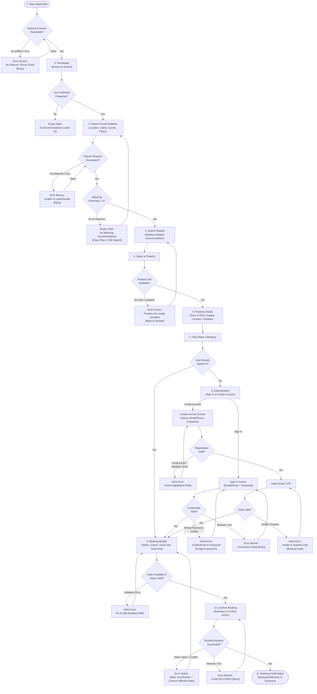
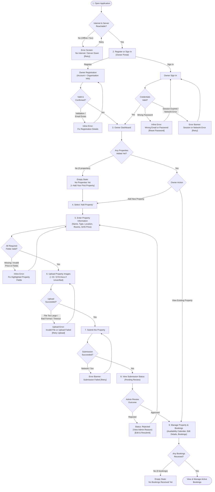
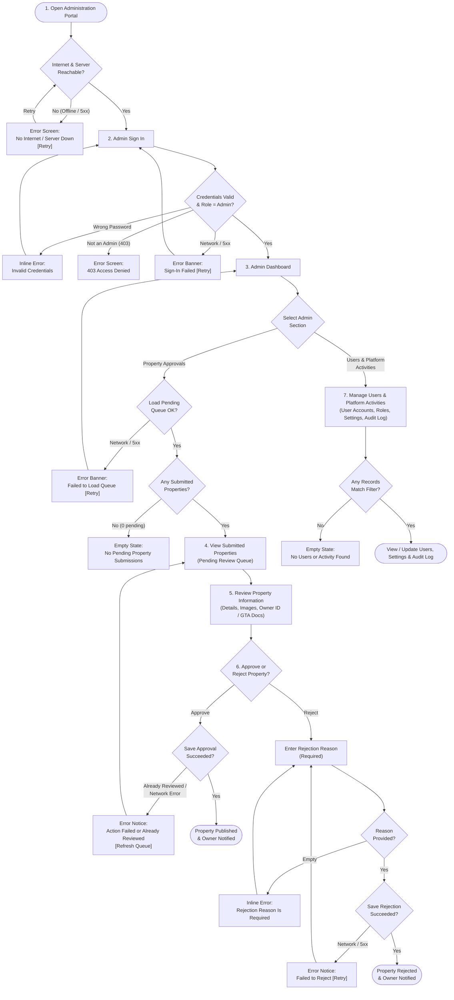

# FindStay — User Flow Diagrams (`S1-01-T3`)

- **Task:** [`S1-01-T3`](../scrum/sprint-01/stories/S1-01/tasks/S1-01-T3.md) (Issue [#27](https://github.com/ObboyeBossman/findstay/issues/27))
- **Story:** [`S1-01`](../scrum/sprint-01/stories/S1-01/README.md) — Project Setup & System Design
- **Author:** Anthony Maclean (`@dztrb`)

This document maps every screen-to-screen path for FindStay's three core user journeys—**Guest**, **Property Owner**, and **Administrator**—including **happy paths**, **error paths**, and **empty states**.

> [!NOTE]
> **Sprint 1 Scope Note:** Sprint 1 delivers Foundation, Auth, Owner Onboarding/Verification, Property Listings, Availability Calendar, and Admin Approval. In the Guest journey below, steps **1–8** map directly to Sprint 1 foundations/listings, while steps **9–11** (Booking Details, Confirm Booking, Booking Confirmation) complete the end-to-end flow for upcoming booking/payment sprints.

---

## Legend

- **Rectangle `[Screen Name]`**: Application screen or view
- **Diamond `{Decision / Condition}`**: Branching check or user choice
- **Rounded `([State / Outcome])`**: Entry point, terminal state, or status
- **Dashed/Error nodes**: Error states (`wrong password`, `no internet`, `server down`, validation/conflict) and empty states (`nothing to show yet`)

---

## 1. Guest Journey (Updated Flow)

### Happy Path
1. Open Application → 2. Homepage (browse & search) → 3. Search Accommodation → 4. Search Results → 5. Select a Property → 6. Property Details (price, images, location, facilities) → 7. Click "Make a Booking" → 8. Authentication (Sign In or Create Account) → 9. Booking Details → 10. Confirm Booking → 11. Booking Confirmation.

---

## 2. Property Owner Journey

### Happy Path
1. Open the application → 2. Register or sign in → 3. Access the owner dashboard → 4. Select Add Property → 5. Enter property information → 6. Upload property images → 7. Submit the property → 8. View submission status → 9. Manage the property and bookings.

---

## 3. Administrator Journey

### Happy Path
1. Open the administration portal → 2. Sign in → 3. Access the admin dashboard → 4. View submitted properties → 5. Review property information → 6. Approve or reject a property → 7. Manage users and platform activities.

---

## 4. Summary of Error Paths & Empty States

| Journey | Error Paths Covered | Empty States Covered |
| :--- | :--- | :--- |
| **Guest** | Offline / server down (`5xx`), search failure, property unavailable (`404`), wrong password, invalid/duplicate registration, invalid/expired OTP, booking validation error, date conflict | No published properties on Homepage; `0` matching accommodations in Search Results |
| **Property Owner** | Offline / server down (`5xx`), wrong password, session expired, registration/property form validation errors, image/document upload failure, submission failure, admin rejection | No properties added yet on Owner Dashboard; `0` bookings received yet |
| **Administrator** | Offline / server down (`5xx`), wrong password, `403 Access Denied` for non-admin, queue load failure, missing rejection reason, concurrent review conflict | No pending property submissions in queue; no matching users or activity logs |
