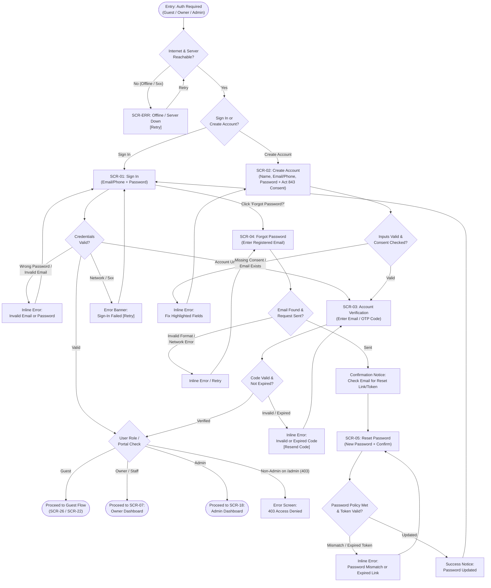
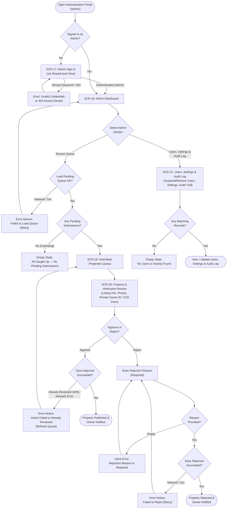
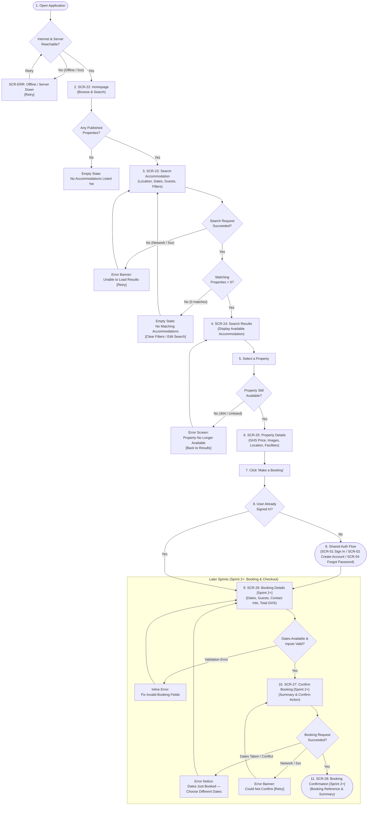

# FindStay — User Flow Diagrams (`S1-01-T3`)

- **Task:** [`S1-01-T3`](../scrum/sprint-01/stories/S1-01/tasks/S1-01-T3.md) (Issue [#27](https://github.com/ObboyeBossman/findstay/issues/27))
- **Story:** [`S1-01`](../scrum/sprint-01/stories/S1-01/README.md) — Project Setup & System Design
- **Author:** Anthony Maclean (`@dztrb`)
- **Status:** Draft (pending `S1-01-T1` confirmation & team review)

This document defines the **numbered screen inventory** and **screen-to-screen user flow diagrams** for FindStay's three journeys (**Shared Auth**, **Property Owner**, **Administrator**, and **Guest**), including **happy paths**, **error paths**, and **empty states**.

> [!NOTE]
> **Sprint 1 Scope:** Sprint 1 delivers Foundation, Auth & Password Recovery (`S1-04`, `S1-05`), Owner Organisation & Staff (`S1-07`), Owner Verification (`S1-12`), Property/Unit Catalog (`S1-13`), Availability Calendar (`S1-14`), and Admin Approval & Management (`S1-15`, `S1-16`). Guest booking steps **9–11** are explicitly marked **`[Sprint 2+]`** inside the Guest diagram.

---

## 1. Numbered Screen Inventory (For `T4` Wireframes & `T6` API Check)

| Screen ID | Screen Name | Story | Scope | One-Line Purpose |
| :--- | :--- | :---: | :---: | :--- |
| **SCR-01** | Sign In | `S1-04` | Sprint 1 | Authenticate existing Guest, Owner, or Admin with email/phone and password. |
| **SCR-02** | Create Account | `S1-04` | Sprint 1 | Register a new user account and accept Act 843 privacy/consent notice (`S1-11`). |
| **SCR-03** | Account Verification (Email / OTP) | `S1-04` | Sprint 1 | Confirm email or phone OTP code after sign-up before first sign-in. |
| **SCR-04** | Forgot Password | `S1-05` | Sprint 1 | Request a password-reset link or OTP by entering registered email. |
| **SCR-05** | Reset Password | `S1-05` | Sprint 1 | Enter and confirm a new password from the recovery link/token. |
| **SCR-06** | User Profile (`/me`) | `S1-05` | Sprint 1 | View and update basic profile details and session settings. |
| **SCR-07** | Owner Dashboard | `S1-07` | Sprint 1 | Central owner/staff workspace showing organisation status, listings, and alerts. |
| **SCR-08** | Organisation & Staff Setup | `S1-07` | Sprint 1 | View company space (`organization_id`) and invite/manage staff roles. |
| **SCR-09** | Owner Verification Upload | `S1-12` | Sprint 1 | Upload Ghana Card, proof of ownership/authorisation, and GTA licence. |
| **SCR-10** | Owner Verification Status | `S1-12` | Sprint 1 | Track verification state (`Pending`, `Approved`, `Rejected` with reason & resubmit). |
| **SCR-11** | Add / Edit Property Form | `S1-13` | Sprint 1 | Create or edit property details, units/rooms, amenities, rules, and GHS pesewa prices. |
| **SCR-12** | Upload Property Images | `S1-09` | Sprint 1 | Upload and reorder property/unit photos (WebP) via pre-signed URLs. |
| **SCR-13** | Property Submission Status | `S1-13` | Sprint 1 | View listing review status (`Draft`, `Pending Review`, `Approved`, `Rejected` + edit). |
| **SCR-14** | Manage Property & Units | `S1-13` | Sprint 1 | View/edit published or draft properties and select a unit to manage. |
| **SCR-15** | Unit Availability Calendar | `S1-14` | Sprint 1 | View a unit's date calendar showing available, booked, and owner-blocked dates. |
| **SCR-16** | Block / Unblock Dates Form | `S1-14` | Sprint 1 | Create, edit, or remove an owner availability block (`availability_block`) for a date range. |
| **SCR-17** | Admin Sign In | `S1-04` | Sprint 1 | Authenticate platform administrator into the `/admin` portal. |
| **SCR-18** | Admin Dashboard | `S1-16` | Sprint 1 | Overview of pending verification/listing queues, user counts, and platform health. |
| **SCR-19** | Submitted Properties Queue | `S1-15` | Sprint 1 | List properties and owner verifications awaiting administrator review. |
| **SCR-20** | Property & Verification Review | `S1-15` | Sprint 1 | Inspect property info, photos, and private owner verification docs; approve or reject with reason. |
| **SCR-21** | Users, Settings & Audit Log | `S1-08`, `S1-16` | Sprint 1 | Manage user accounts/roles, platform settings, and view append-only `audit_log`. |
| **SCR-22** | Homepage (Browse & Search) | `S1-03` | Sprint 1 | Public landing page where guests browse featured listings and start a search. |
| **SCR-23** | Search Accommodation | `S1-03` | Sprint 1 | Enter destination, dates, guest count, and price/amenity filters. |
| **SCR-24** | Search Results | `S1-03` | Sprint 1 | Display available accommodations matching filters (or empty state). |
| **SCR-25** | Property Details | `S1-13` | Sprint 1 | View property photos, GHS pricing, location, facilities, and "Make a Booking" CTA. |
| **SCR-26** | Booking Details `[Sprint 2+]` | `S2+` | Sprint 2+ | Enter/confirm stay dates, guest count, and contact details before checkout. |
| **SCR-27** | Confirm Booking `[Sprint 2+]` | `S2+` | Sprint 2+ | Review booking summary and confirm reservation (and payment in Sprint 2+). |
| **SCR-28** | Booking Confirmation `[Sprint 2+]` | `S2+` | Sprint 2+ | Display confirmed booking reference and summary. |
| **SCR-ERR** | Global Offline / Server Error | `S1-03` | Sprint 1 | Shown when internet is offline or API returns `5xx`, with a `[Retry]` action. |

---

## 2. Shared Flow: Authentication & Password Recovery (`SCR-01` – `SCR-06`)

All three journeys (**Guest**, **Property Owner**, **Administrator**) enter this shared flow whenever authentication is required.

---

## 3. Property Owner Journey (Sprint 1 Core)

Covers **Owner Onboarding (`S1-07`)**, **Owner Verification (`S1-12`)**, **Property & Unit Creation (`S1-13`)**, **Image Upload (`S1-09`)**, **Submission Status (`S1-13`)**, and **Availability Calendar (`S1-14`)**.

```mermaid
flowchart TD
    Start(["Open Application<br/>(/owner)"]) --> AuthCheck{"Signed In as<br/>Owner / Staff?"}
    AuthCheck -- "No" --> SharedAuth(["Shared Auth Flow<br/>(SCR-01 / SCR-02 / SCR-04)"])
    SharedAuth --> SCR07

    AuthCheck -- "Yes" --> SCR07["SCR-07: Owner Dashboard"]
    SCR07 --> OrgCheck{"Organisation<br/>Set Up?"}
    OrgCheck -- "Manage Org / Staff" --> SCR08["SCR-08: Organisation & Staff Setup<br/>(Company Space + Invite Staff)"]
    SCR08 --> SCR07

    %% Verification Flow (S1-12)
    SCR07 --> VerifCheck{"Owner Verification<br/>Status?"}
    VerifCheck -- "Not Submitted" --> SCR09["SCR-09: Owner Verification Upload<br/>(Ghana Card, Ownership Proof, GTA Licence)"]
    SCR09 --> VerifUploadOK{"Upload & Submit<br/>Succeeded?"}
    VerifUploadOK -- "File Too Large /<br/>Bad Format / Timeout" --> ErrVerifUpload["Upload Error:<br/>Invalid File or Timeout [Retry]"]
    ErrVerifUpload --> SCR09
    VerifUploadOK -- "Yes" --> SCR10["SCR-10: Owner Verification Status<br/>(Pending / Approved / Rejected)"]

    VerifCheck -- "Pending / Rejected" --> SCR10
    SCR10 -- "Rejected (View Reason)" --> SCR09
    SCR10 -- "Approved" --> DashState

    %% Property & Listing Flow (S1-13)
    VerifCheck -- "Approved" --> DashState{"Any Properties<br/>Added Yet?"}
    DashState -- "No (0 properties)" --> EmptyProps["Empty State:<br/>No Properties Yet<br/>[+ Add Your First Property]"]
    EmptyProps --> SCR11

    DashState -- "Yes" --> OwnerAction{"Owner Action"}
    OwnerAction -- "Add Property" --> SCR11["SCR-11: Add / Edit Property Form<br/>(Name, Type, Location, Units, GHS Prices)"]
    SCR11 --> PropFormOK{"Required Fields &<br/>Pesewa Rates Valid?"}
    PropFormOK -- "Validation Error" --> ErrPropForm["Inline Error:<br/>Fix Highlighted Property Fields"]
    ErrPropForm --> SCR11

    PropFormOK -- "Yes" --> SCR12["SCR-12: Upload Property Images<br/>(WebP Photos via Pre-Signed URL)"]
    SCR12 --> ImgOK{"Image Upload<br/>Succeeded?"}
    ImgOK -- "Invalid Format /<br/>Size / Timeout" --> ErrImg["Upload Error:<br/>Retry Image Upload"]
    ErrImg --> SCR12

    ImgOK -- "Yes" --> SubmitProp{"Submit Property<br/>for Review?"}
    SubmitProp -- "Network / 5xx" --> ErrSub["Error Banner:<br/>Submission Failed [Retry]"]
    ErrSub --> SCR12
    SubmitProp -- "Yes" --> SCR13["SCR-13: Property Submission Status<br/>(Pending Review)"]

    SCR13 --> ReviewOutcome{"Admin Review<br/>Outcome"}
    ReviewOutcome -- "Rejected" --> PropRejected["Status: Rejected<br/>(View Admin Reason)<br/>[Edit & Resubmit]"]
    PropRejected --> SCR11
    ReviewOutcome -- "Approved" --> SCR14

    %% Manage Property & Availability Calendar (S1-14)
    OwnerAction -- "Manage Existing Property" --> SCR14["SCR-14: Manage Property & Units<br/>(Select Unit / View Bookings)"]
    SCR14 --> ManageChoice{"Select Action"}

    ManageChoice -- "View Bookings [Sprint 2+]" --> BookingsCheck{"Any Bookings<br/>Received?"}
    BookingsCheck -- "No (0 bookings)" --> EmptyBook["Empty State:<br/>No Bookings Received Yet"]
    BookingsCheck -- "Yes" --> BookingsList(["View & Manage Bookings"])

    ManageChoice -- "Availability Calendar" --> SCR15["SCR-15: Unit Availability Calendar<br/>(Available / Booked / Blocked Dates)"]
    SCR15 --> CalLoadOK{"Calendar Loaded?"}
    CalLoadOK -- "Network / 5xx" --> ErrCalLoad["Error Banner:<br/>Could Not Load Calendar [Retry]"]
    ErrCalLoad --> SCR15

    CalLoadOK -- "Yes" --> CalAction{"Calendar Action"}
    CalAction -- "Block / Edit / Unblock Dates" --> SCR16["SCR-16: Block / Unblock Dates Form<br/>(Start Date, End Date, Reason)"]
    SCR16 --> CalSave{"Save Block<br/>Succeeded?"}
    CalSave -- "Overlap Conflict (409)<br/>(btree_gist)" --> ErrOverlap["Conflict Error:<br/>Dates Overlap an Existing Block/Booking"]
    ErrOverlap --> SCR16
    CalSave -- "Invalid Date Range" --> ErrDateRange["Inline Error:<br/>End Date Must Follow Start Date"]
    ErrDateRange --> SCR16
    CalSave -- "Saved" --> SCR15
```

---

## 4. Administrator Journey (Sprint 1 Core)

Covers **Admin Sign In**, **Dashboard (`S1-16`)**, **Pending Review Queue (`S1-15`)**, **Approve / Reject (`S1-15`)**, and **Users, Settings & Audit Log (`S1-08`, `S1-16`)**.

---

## 5. Guest Journey (Updated Flow)

Covers **Browse & Search (`SCR-22` – `SCR-25`)** in Sprint 1, **Shared Auth (`SCR-01` – `SCR-05`)**, and clearly marks **Booking (`SCR-26` – `SCR-28`)** as **`[Sprint 2+]`**.

---

## 6. Summary of Error Paths & Empty States

| Flow | Error Paths Covered | Empty States Covered |
| :--- | :--- | :--- |
| **Shared Auth & Recovery** | Offline/server down (`SCR-ERR`), wrong password/invalid email, unverified account redirect, duplicate email/missing Act 843 consent, invalid/expired OTP, expired reset token/password mismatch, `403 Access Denied` | — |
| **Property Owner** | Verification/image upload failure (size, format, timeout), property form validation, submission failure, admin rejection with reason, calendar load failure, `btree_gist` date-overlap conflict (`409`), invalid date range | `0` properties on Owner Dashboard; `0` bookings received |
| **Administrator** | Wrong credentials, `403 Access Denied`, queue load failure, missing rejection reason, concurrent review conflict (`409`) | `0` pending submissions in review queue; `0` matching users/activity logs |
| **Guest** | Offline/server down (`SCR-ERR`), search failure, property unavailable (`404`), booking validation error `[Sprint 2+]`, date conflict `[Sprint 2+]` | `0` published properties on Homepage; `0` matching search results |
